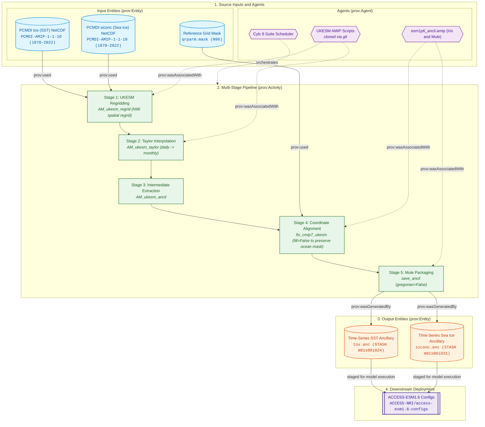

# AMIP (SST & Sea Ice) Forcing Specifications

The AMIP (Atmospheric Model Intercomparison Project) forcing pipeline ingests observed sea surface temperature (SST) and sea-ice concentration fields from PCMDI to generate monthly boundary condition ancillary files (`.anc`) for prescribed-ocean experiments in ACCESS-ESM1.6.

---

## Physical Domain & Scientific Scope

* **Boundary Variables Generated:**
  1. **Sea Surface Temperature (`sst`):** Monthly mean sea surface skin temperature. Target STASH item: `m01s00i024` (SURFACE TEMPERATURE AFTER TIMESTEP).
  2. **Sea Ice Concentration (`seaice`):** Fractional area of grid cell covered by sea ice. Target STASH items: `m01s00i031` / `m01s00i032` (SEA ICE FRACTION).
* **Source Dataset:** PCMDI AMIP observational boundary dataset (`PCMDI-AMIP-1-1-10`, `v20250807`) spanning 1870 to 2022.
* **UKESM Intermediate Processing:**
  Utilizes the UK Met Office AMIP toolchain (`ancillary-file-science` on branch `1-port-cmip7-amip-code-for-esm16-site-nci`) to regrid PCMDI observations to the N96 atmospheric grid while applying area-preserving Taylor regridding and land-sea mask consistency adjustments.
* **Preservation of Ocean Cells:**
  Unlike land ancillaries which fill missing values with 0.0, AMIP ancillaries maintain strict ocean masks (`fill=False` in `fix_cmip7_ukesm`) to avoid corrupting coastal marine boundary temperatures.

---

## Provenance & Dataflow Architecture

The AMIP pipeline follows the W3C PROV framework, integrating upstream UKESM spatial regridding, Taylor temporal interpolation, and in-house Mule packaging with strict ocean mask preservation:





---

## Controlling Suite Switches

The execution, experiment inclusion, and script branches for the AMIP pipeline are controlled by parameters in [`rose-suite.conf`](../configuration/suite_objects.md):

* **Master Activation Switch:** `ANCIL_CREATE_AMIP = true`  
  When set to `false`, all AMIP regridding and ancillary generation tasks are excluded from the Cylc task graph.
* **Experiment Activation:** Governed by `USE_EXP['AM'] = True`.
* **Variables Processed:** `AMIP_VARS = ['seaice', 'sst']`.
* **Upstream Scripts Branching:** Clones the AMIP regridding toolchain from `${GIT_ORG_URL}/${GIT_AMIP_SCRIPTS_REPO}.git` on branch `${GIT_AMIP_SCRIPTS_BRANCH}` (`1-port-cmip7-amip-code-for-esm16-site-nci`).
* **Reference:** See [Suite Configuration & Parameters Reference](../configuration/suite_objects.md) for full object declarations.

---

## 1. AMIP Infrastructure Tasks

### `git_clone_amip_scripts`
* **1. Description & Purpose:** Clones the AMIP processing repository from GitHub (`${GIT_ORG_URL}/${GIT_AMIP_SCRIPTS_REPO}` on branch `${GIT_AMIP_SCRIPTS_BRANCH}`) into `${CYLC_WORKFLOW_SHARE_DIR}/${GIT_AMIP_SCRIPTS_REPO}-amip`.
* **2. Execution:** `git clone --depth 1 -b ${GIT_AMIP_SCRIPTS_BRANCH} ${GIT_ORG_URL}/${GIT_AMIP_SCRIPTS_REPO}.git`.
* **7 & 8. Output:** Cloned directory in workflow share directory.

### `install_amip`
* **1. Description & Purpose:** Installs the cloned AMIP scripts and Python dependencies into the suite's environment.
* **2. Execution:** `pip install --no-deps -e ${CYLC_WORKFLOW_SHARE_DIR}/${GIT_AMIP_SCRIPTS_REPO}-amip`.

---

## 2. Upstream UKESM Regridding Tasks

### `AM_ukesm_regrid`
* **1. Description & Purpose:** Regrids raw monthly PCMDI SST and sea ice NetCDF files to the target N96 resolution using conservative interpolation.
* **3. Input4MIPs Version:** `${CMIP7_AMIP_VERSION}` (`PCMDI-AMIP-1-1-10`), `${CMIP7_AMIP_VDATE}` (`v20250807`), Range: `${CMIP7_AMIP_DATE_RANGE}` (`187001-202212`).
* **4. Input4MIPs Path:** `${VAR.CMIP7_SOURCE_PATH}/AMIP/PCMDI/${CMIP7_AMIP_VERSION}/ocean/mon/{var}/gn/${CMIP7_AMIP_VDATE}/`  
  *(Evaluated: `/g/data/qv56/replicas/input4MIPs/CMIP7/AMIP/PCMDI/PCMDI-AMIP-1-1-10/ocean/mon/{var}/gn/v20250807/`)*

### `AM_ukesm_taylor`
* **1. Description & Purpose:** Applies Taylor diagram verification and conservative flux-conserving smoothing to the regridded SST and sea-ice fields.

### `AM_ukesm_ancil`
* **1. Description & Purpose:** Packages the regridded fields into standardized UKESM intermediate NetCDF files: `${UKESM_AMIP_NETCDF_FILENAME['seaice']}` (`seaice_amip_n96_gregorian.nc`) and `${UKESM_AMIP_NETCDF_FILENAME['sst']}` (`sst_amip_n96_gregorian.nc`).

---

## 3. UM Binary Ancillary Generation Tasks

### `AM_seaice_ancil_amip`

* **1. Description & Purpose:** Reads the intermediate `${UKESM_AMIP_NETCDF_FILENAME['seaice']}` file, aligns coordinate definitions with the ACCESS-ESM1.6 N96 grid mask without zero-filling ocean points, and produces `${ESM_AMIP_SAVE_FILENAME['seaice']}` (`seaice_amip_n96_gregorian.anc`).
* **2. CLI Arguments Passed:**
  ```bash
  python -m esm1p6_ancil.amip.cmip7_AM_amip_generate \
      --ancil-target-dirname "${VAR.ANCIL_TARGET_PATH}" \
      # Current: "/g/data/${PROJECT}/${USER}/CMIP7/esm1p6_ancil/$(isodatetime -f CCYY.MM.DD)"
      --cmip7-source-data-dirname "${VAR.CMIP7_SOURCE_PATH}" \
      # Current: "/g/data/qv56/replicas/input4MIPs/CMIP7"
      --esm15-inputs-dirname "${VAR.ESM15_INPUTS_PATH}" \
      # Current: "/g/data/vk83/configurations/inputs/access-esm1p5"
      --esm-grid-rel-dirname "${ESM_GRID_DIRNAME}" \
      # Current: "global.N96"
      --esm15-grid-version "${ESM15_GRID_VERSION}" \
      # Current: "2020.05.19"
      --ukesm-ancil-dirpath "${CYLC_WORKFLOW_SHARE_DIR}/" \
      --ukesm-netcdf-filename "${UKESM_AMIP_NETCDF_FILENAME['seaice']}" \
      # Current: "seaice_amip_n96_gregorian.nc"
      --save-filename "${ESM_AMIP_SAVE_FILENAME['seaice']}"
      # Current: "seaice_amip_n96_gregorian.anc"
  ```
* **5. Scripts & Functions:** `esm1p6_ancil.amip.cmip7_AM_amip_generate`, `load_cmip7_ukesm`, `fix_cmip7_ukesm`, `save_cmip7_am_amip`, `save_ancil`.
* **6. Cube Transformations:**
    * Loads 3D sea-ice cube `(time, lat, lon)` spanning 1870–2022.
    * Adjusts latitude and longitude coordinate metadata via `fix_cmip7_ukesm(args, ukesm_cube, fill=False)`.
    * Passes cube to `save_ancil` with `gregorian=False` to preserve standard 360-day or Proleptic Gregorian time headers.
* **7. Produced Ancillary:** `${ESM_AMIP_SAVE_FILENAME['seaice']}` (`seaice_amip_n96_gregorian.anc`, 1836 monthly slices, 1870–2022).
* **8. Destination Path:** `${VAR.ANCIL_TARGET_PATH}/modern/amip/atmosphere/boundary_conditions/${ESM_GRID_DIRNAME}/<DATE>/${ESM_AMIP_SAVE_FILENAME['seaice']}`.
* **9. Namelist Updates:** `None (Generates binary ancillary .anc file)`.

### `AM_sst_ancil_amip`

* **1. Description & Purpose:** Reads `${UKESM_AMIP_NETCDF_FILENAME['sst']}`, validates SST Kelvin units, aligns coordinates without zero-filling ocean cells, and produces `${ESM_AMIP_SAVE_FILENAME['sst']}` (`sst_amip_n96_gregorian.anc`).
* **2. CLI Arguments Passed:**
  ```bash
  python -m esm1p6_ancil.amip.cmip7_AM_amip_generate \
      --ancil-target-dirname "${VAR.ANCIL_TARGET_PATH}" \
      # Current: "/g/data/${PROJECT}/${USER}/CMIP7/esm1p6_ancil/$(isodatetime -f CCYY.MM.DD)"
      --cmip7-source-data-dirname "${VAR.CMIP7_SOURCE_PATH}" \
      # Current: "/g/data/qv56/replicas/input4MIPs/CMIP7"
      --esm15-inputs-dirname "${VAR.ESM15_INPUTS_PATH}" \
      # Current: "/g/data/vk83/configurations/inputs/access-esm1p5"
      --esm-grid-rel-dirname "${ESM_GRID_DIRNAME}" \
      # Current: "global.N96"
      --esm15-grid-version "${ESM15_GRID_VERSION}" \
      # Current: "2020.05.19"
      --ukesm-ancil-dirpath "${CYLC_WORKFLOW_SHARE_DIR}/" \
      --ukesm-netcdf-filename "${UKESM_AMIP_NETCDF_FILENAME['sst']}" \
      # Current: "sst_amip_n96_gregorian.nc"
      --save-filename "${ESM_AMIP_SAVE_FILENAME['sst']}"
      # Current: "sst_amip_n96_gregorian.anc"
  ```
* **7. Produced Ancillary:** `${ESM_AMIP_SAVE_FILENAME['sst']}` (`sst_amip_n96_gregorian.anc`, 1836 monthly slices, 1870–2022).
* **8. Destination Path:** `${VAR.ANCIL_TARGET_PATH}/modern/amip/atmosphere/boundary_conditions/${ESM_GRID_DIRNAME}/<DATE>/${ESM_AMIP_SAVE_FILENAME['sst']}`.
* **9. Namelist Updates:** `None (Generates binary ancillary .anc file)`.
