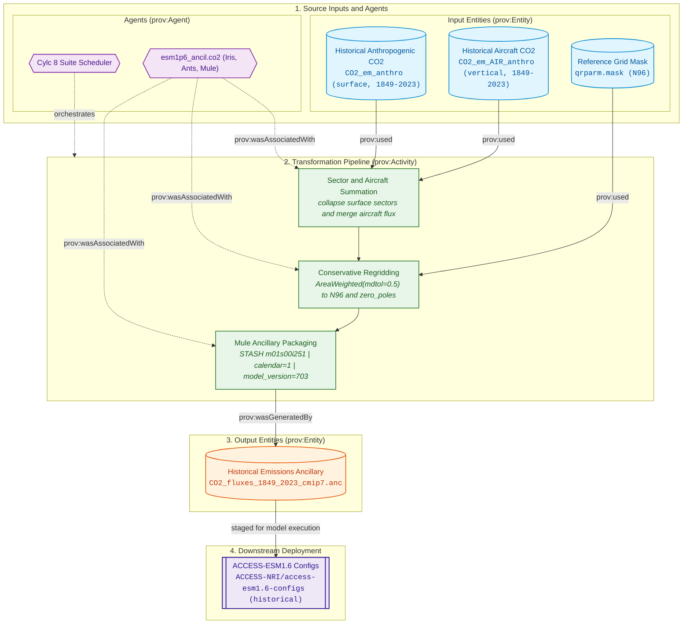
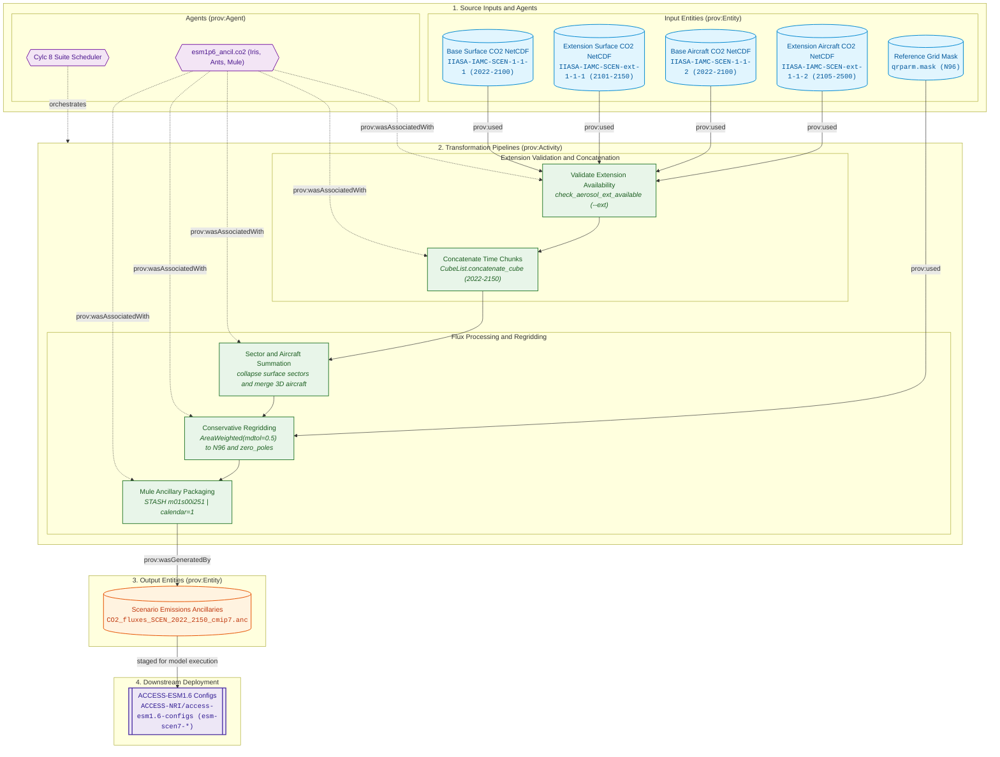

# Carbon Dioxide (CO2) Fluxes Forcing Specifications

The carbon dioxide flux pipeline processes monthly gridded anthropogenic surface and aircraft carbon dioxide emissions to produce Unified Model binary ancillary files (`.anc`) for emission-driven climate experiments in ACCESS-ESM1.6 (experiments `EH` and `ES`).

---

## Physical Domain & Scientific Scope

* **Scientific Purpose:** In standard concentration-driven simulations (`HI`, `SM`), atmospheric CO2 is prescribed via global-mean surface concentrations in `&clmchfcg`. In contrast, in emission-driven Earth System Model simulations (`EH`, `ES`), atmospheric CO2 evolves interactively through coupled carbon-cycle fluxes between the atmosphere, the CABLE land surface model, and the WOMBAT ocean biogeochemistry model, driven by prescribed spatially resolved emissions fluxes.
* **Target STASH Item:** `m01s00i251` (SURFACE CO2 EMISSIONS / CO2_FLUXES).
* **Grid & Interpolation:** Conservative area-weighted regridding (`AreaWeighted(mdtol=0.5)`) from $0.5^\circ$ native grid to `global.N96` ($1.875^\circ \times 1.25^\circ$), with polar boundary zeroing (`zero_poles`).
* **Source Components Combined:** Surface anthropogenic emissions (`CO2_em_anthro`, sum across economic sectors) plus 3D aircraft emissions collapsed vertically (`CO2_em_AIR_anthro`).

---

## Provenance & Dataflow Architecture

The carbon dioxide flux pipeline follows the W3C PROV framework, collapsing multi-sector surface emissions and vertical aircraft fluxes, regridding conservatively to the N96 grid, and manufacturing binary ancillaries for emission-driven experiments:
* **Historical Emission-Driven (`EH`):** Sums historical anthropogenic surface and aircraft emissions (1849–2023), regrids conservatively to N96, and packages continuous monthly time-series ancillaries. See [Historical Emission-Driven Dataflow Architecture](#eh-dataflow).
* **ScenarioMIP Emission-Driven (`ES`):** Ingests baseline surface/aircraft projections alongside multi-century extension chunks (`*-ext-*`), concatenates temporal series to 2150, regrids conservatively to N96, and manufactures future emission ancillaries. See [ScenarioMIP Emission-Driven Dataflow Architecture](#es-dataflow).
* **Idealised CDR (`esm-flat10-cdr`):** Synthesizes an idealized carbon dioxide removal linear ramp from $+10\,\text{PgC}\,\text{yr}^{-1}$ to $-10\,\text{PgC}\,\text{yr}^{-1}$.

---

## Controlling Suite Switches

The execution, experiment inclusion, and temporal extension for interactive CO2 emissions fluxes are governed by parameters in [`rose-suite.conf`](../configuration/suite_objects.md):

* **Master Activation Switch:** `ANCIL_CREATE_CO2 = true`  
  When set to `false`, all interactive CO2 flux tasks are excluded from the Cylc task graph.
* **Experiment Activation:** Governed by `USE_EXP['EH']` (Historical Emission-Driven) and `USE_EXP['ES']` (ScenarioMIP Emission-Driven).
* **Scenario Extension Controls (`EXTEND_SM_CO2`):**  
  Controls whether future emission scenarios pass `--ext` to concatenate 2150 extensions:
    * `'h': True` (Extended to 2150 via `IIASA-IAMC-h-ext-1-1-1`, producing `${ESM_ES_EXT_CO2_SAVE_FILENAME['h']}`)
    * `'hl': False` (Bounded to 2100, producing `${ESM_ES_CO2_SAVE_FILENAME['hl']}`)
    * `'m': False` (Bounded to 2100, producing `${ESM_ES_CO2_SAVE_FILENAME['m']}`)
    * `'vl': True` (Extended to 2150 via `IIASA-IAMC-vl-ext-1-1-1`, producing `${ESM_ES_EXT_CO2_SAVE_FILENAME['vl']}`)
* **Reference:** See [Suite Configuration & Parameters Reference](../configuration/suite_objects.md) for full object declarations.

---

## 1. Emission-Driven Historical Experiment (EH)

<a id="eh-dataflow"></a>
### Dataflow Architecture

The emissions-driven historical workflow aggregates historical gridded surface and aircraft emissions (1849–2023), regrids conservatively to N96, and packages monthly binary ancillaries:





### `EH_ancil_co2`

* **1. Description & Purpose:**  
  Generates historical gridded CO2 emissions fluxes spanning 1849 to 2023. Ingests anthropogenic surface emissions and aircraft emissions, sums sectors, regrids conservatively to N96, assigns STASH item 251, and saves `${ESM_EH_CO2_SAVE_FILENAME}` (`CO2_fluxes_1849_2023_cmip7.anc`).
* **2. CLI Arguments Passed:**  
  ```bash
  python -m esm1p6_ancil.co2.cmip7_EH_CO2_interpolate \
      --ancil-target-dirname "${VAR.ANCIL_TARGET_PATH}" \
      # Current: "/g/data/${PROJECT}/${USER}/CMIP7/esm1p6_ancil/$(isodatetime -f CCYY.MM.DD)"
      --cmip7-source-data-dirname "${VAR.CMIP7_SOURCE_PATH}" \
      # Current: "/g/data/qv56/replicas/input4MIPs/CMIP7"
      --esm15-inputs-dirname "${VAR.ESM15_INPUTS_PATH}" \
      # Current: "/g/data/vk83/configurations/inputs/access-esm1p5"
      --esm-grid-rel-dirname "${ESM_GRID_DIRNAME}" \
      # Current: "global.N96"
      --esm15-grid-version "${ESM15_GRID_VERSION}" \
      # Current: "2020.05.19"
      --dataset-version "${CMIP7_AEROSOL_ANTHRO_VERSION}" \
      # Current: "CEDS-CMIP-2025-04-18"
      --dataset-vdate "${CMIP7_AEROSOL_ANTHRO_VDATE}" \
      # Current: "v20250421"
      --dataset-date-range-list "${CMIP7_HI_AEROSOL_ANTHRO_DATE_RANGE_LIST}" \
      # Current: "['180001-184912','185001-189912','190001-194912','195001-199912','200001-202312']"
      --save-filename "${ESM_EH_CO2_SAVE_FILENAME}"
      # Current: "CO2_fluxes_1849_2023_cmip7.anc"
  ```
* **3. Input4MIPs Versions & Temporal Metadata:**  
    * **Dataset Version:** `${CMIP7_AEROSOL_ANTHRO_VERSION}` (`CEDS-CMIP-2025-04-18`)
    * **Version Date (`vdate`):** `${CMIP7_AEROSOL_ANTHRO_VDATE}` (`v20250421`)
    * **Input Date Range List:** `${CMIP7_HI_AEROSOL_ANTHRO_DATE_RANGE_LIST}` (`['180001-184912', ..., '200001-202312']`)
    * **Processed Model Timeline:** `184901-202312` (2100 monthly slices)
* **4. Input4MIPs Directory Path & Filenames:**  
    * **Surface Path:** `${VAR.CMIP7_SOURCE_PATH}/CMIP/CEDS/${CMIP7_AEROSOL_ANTHRO_VERSION}/atmos/mon/CO2_em_anthro/gn/${CMIP7_AEROSOL_ANTHRO_VDATE}/`  
      *(Evaluated: `/g/data/qv56/replicas/input4MIPs/CMIP7/CMIP/CEDS/CEDS-CMIP-2025-04-18/atmos/mon/CO2_em_anthro/gn/v20250421/`)*
    * **Aircraft Path:** `${VAR.CMIP7_SOURCE_PATH}/CMIP/CEDS/${CMIP7_AEROSOL_ANTHRO_VERSION}/atmos/mon/CO2_em_AIR_anthro/gn/${CMIP7_AEROSOL_ANTHRO_VDATE}/`  
      *(Evaluated: `/g/data/qv56/replicas/input4MIPs/CMIP7/CMIP/CEDS/CEDS-CMIP-2025-04-18/atmos/mon/CO2_em_AIR_anthro/gn/v20250421/`)*
* **5. Python Scripts & Functions:**  
    * **Main Script / Entrypoint:** `esm1p6_ancil.co2.cmip7_EH_CO2_interpolate`
    * **Key Functions Called:** `cmip7_eh_co2_anthro_interpolate`, `load_cmip7_hi_aerosol_anthro`, `load_cmip7_hi_aerosol_air_anthro`, `esm_grid_mask_cube`, `zero_poles`, `save_ancil`
    * **Shared Libraries:** `iris`, `mule`, `ants`, `numpy`
* **6. Function-Level Cube Transformations & Constraints:**  
    * **Input Cubes & Coordinates:** Surface emissions cube `(time, sector, lat, lon)` and aircraft emissions cube `(time, altitude, lat, lon)`.
    * **Constraints Applied:** Date range constraint `cmip7_date_constraint_from_years(1849, 2023)` using `cftime.DatetimeNoLeap`.
    * **Coordinate Bounds & Manipulation:**
        * Surface sector coordinate collapsed via `cube.collapsed(["sector"], iris.analysis.SUM)` and removed via `remove_coord("sector")`.
        * Aircraft altitude coordinate collapsed via `cube_air.collapsed(["altitude"], iris.analysis.SUM)` and removed.
        * Combined total flux: `cube_tot = cube + cube_air`.
        * Regridded conservatively to target N96 grid using `AreaWeighted(mdtol=0.5)`. Missing values zeroed (`data.filled(0.0)`).
        * Polar singularity zeroed via `zero_poles(esm_cube)`.
        * Assigned STASH item `m01s00i251`.
    * **Created / Output Cubes:** Formats final 3D cube `(time: 2100, lat: 144, lon: 192)` passed to `save_ancil`.
* **7. Produced File Versions & Date Ranges:**  
    * **Temporal Coverage:** `184901-202312` (2100 monthly slices, including 1849 model spin-up padding)
    * **Calendar:** 365-day (NoLeap) calendar alignment
    * **STASH Code:** `m01s00i251`
* **8. Produced File Directory Paths & Filenames:**  
    * **Output Directory:** `${VAR.ANCIL_TARGET_PATH}/modern/historical-emissions/atmosphere/forcing/${ESM_GRID_DIRNAME}/<ANCIL_TODAY>/`
    * **Output Filename:** `${ESM_EH_CO2_SAVE_FILENAME}` (`CO2_fluxes_1849_2023_cmip7.anc`)
* **9. Namelist File & Variable Updates:**  
  `None (Generates binary ancillary .anc file)`.

---

## 2. Emission-Driven ScenarioMIP Experiment (ES)

<a id="es-dataflow"></a>
### Dataflow Architecture

The ScenarioMIP emissions-driven workflow combines baseline surface and aircraft emissions (2022–2100) with extension dataset chunks (`*-ext-*`, 2101–2150 / 2105–2500) when `--ext` is specified, validating extension files, concatenating continuous time series, regridding to N96, and packaging future emissions ancillaries:





### `ES_{h,hl,m,vl}_ancil_co2`

Tasks generate future projection CO2 emissions fluxes across scenarios `h`, `hl`, `m`, and `vl`, with automatic extension to 2150 when `--ext` is specified.

=== "Scenario h (High)"
    * **1. Description & Purpose:** Generates future surface CO2 emissions fluxes for ScenarioMIP scenario `h` (2022–2150). Combines surface and aircraft emissions, validates extension file availability via `check_aerosol_ext_available`, regrids conservatively to N96, and produces `${ESM_ES_EXT_CO2_SAVE_FILENAME['h']}` (`CO2_fluxes_h_2022_2150_cmip7.anc`).
    * **2. CLI Arguments Passed:**
      ```bash
      python -m esm1p6_ancil.co2.cmip7_ES_CO2_interpolate \
          --scenario "${SCEN}" \
          # Current: "h"
          --ancil-target-dirname "${VAR.ANCIL_TARGET_PATH}" \
          # Current: "/g/data/${PROJECT}/${USER}/CMIP7/esm1p6_ancil/$(isodatetime -f CCYY.MM.DD)"
          --cmip7-source-data-dirname "${VAR.CMIP7_SOURCE_PATH}" \
          # Current: "/g/data/qv56/replicas/input4MIPs/CMIP7"
          --esm15-inputs-dirname "${VAR.ESM15_INPUTS_PATH}" \
          # Current: "/g/data/vk83/configurations/inputs/access-esm1p5"
          --esm-grid-rel-dirname "${ESM_GRID_DIRNAME}" \
          # Current: "global.N96"
          --esm15-grid-version "${ESM15_GRID_VERSION}" \
          # Current: "2020.05.19"
          --dataset-version "${CMIP7_SM_AEROSOL_VERSION[SCEN]}" \
          # Current: "IIASA-IAMC-h-1-1-1"
          --dataset-vdate "${CMIP7_SM_AEROSOL_VDATE[SCEN]}" \
          # Current: "v20260409"
          --dataset-date-range "${CMIP7_SM_AEROSOL_DATE_RANGE}" \
          # Current: "202201-210012"
          --dataset-air-version "${CMIP7_SM_AEROSOL_AIR_VERSION[SCEN]}" \
          # Current: "IIASA-IAMC-h-1-1-2"
          --dataset-air-vdate "${CMIP7_SM_AEROSOL_AIR_VDATE[SCEN]}" \
          # Current: "v20260624"
          --ext \
          --dataset-ext-version "${CMIP7_SM_EXT_AEROSOL_VERSION[SCEN]}" \
          # Current: "IIASA-IAMC-h-ext-1-1-1"
          --dataset-ext-vdate "${CMIP7_SM_EXT_AEROSOL_VDATE[SCEN]}" \
          # Current: "v20260409"
          --dataset-ext-date-range "${CMIP7_SM_EXT_AEROSOL_DATE_RANGE}" \
          # Current: "210101-215012"
          --dataset-air-ext-version "${CMIP7_SM_EXT_AEROSOL_AIR_VERSION[SCEN]}" \
          # Current: "IIASA-IAMC-h-ext-1-1-2"
          --dataset-air-ext-vdate "${CMIP7_SM_EXT_AEROSOL_AIR_VDATE[SCEN]}" \
          # Current: "v20260804"
          --dataset-air-ext-date-range "${CMIP7_SM_EXT_AEROSOL_AIR_DATE_RANGE}" \
          # Current: "210501-250012"
          --save-filename "${ESM_ES_EXT_CO2_SAVE_FILENAME[SCEN]}"
          # Current: "CO2_fluxes_h_2022_2150_cmip7.anc"
      ```
    * **3. Input4MIPs Versions & Temporal Metadata:**
        * Surface Base: `${CMIP7_SM_AEROSOL_VERSION['h']}` (`IIASA-IAMC-h-1-1-1`), `${CMIP7_SM_AEROSOL_VDATE['h']}` (`v20260409`), `${CMIP7_SM_AEROSOL_DATE_RANGE}` (`202201-210012`)
        * Surface Ext: `${CMIP7_SM_EXT_AEROSOL_VERSION['h']}` (`IIASA-IAMC-h-ext-1-1-1`), `${CMIP7_SM_EXT_AEROSOL_VDATE['h']}` (`v20260409`), `${CMIP7_SM_EXT_AEROSOL_DATE_RANGE}` (`210101-215012`)
        * Aircraft Base: `${CMIP7_SM_AEROSOL_AIR_VERSION['h']}` (`IIASA-IAMC-h-1-1-2`), `${CMIP7_SM_AEROSOL_AIR_VDATE['h']}` (`v20260624`), `${CMIP7_SM_AEROSOL_DATE_RANGE}` (`202201-210012`)
        * Aircraft Ext: `${CMIP7_SM_EXT_AEROSOL_AIR_VERSION['h']}` (`IIASA-IAMC-h-ext-1-1-2`), `${CMIP7_SM_EXT_AEROSOL_AIR_VDATE['h']}` (`v20260804`), `${CMIP7_SM_EXT_AEROSOL_AIR_DATE_RANGE}` (`210501-250012`)
    * **4. Input4MIPs Directory Path & Filenames:**
        * Surface Base: `${VAR.CMIP7_SOURCE_PATH}/ScenarioMIP/IIASA-IAMC/${CMIP7_SM_AEROSOL_VERSION['h']}/atmos/mon/CO2_em_anthro/gn/${CMIP7_SM_AEROSOL_VDATE['h']}/CO2-em-anthro_input4MIPs_emissions_ScenarioMIP_${CMIP7_SM_AEROSOL_VERSION['h']}_gn_${CMIP7_SM_AEROSOL_DATE_RANGE}.nc`
        * Surface Ext: `${VAR.CMIP7_SOURCE_PATH}/ScenarioMIP/IIASA-IAMC/${CMIP7_SM_EXT_AEROSOL_VERSION['h']}/atmos/mon/CO2_em_anthro/gn/${CMIP7_SM_EXT_AEROSOL_VDATE['h']}/CO2-em-anthro_input4MIPs_emissions_ScenarioMIP_${CMIP7_SM_EXT_AEROSOL_VERSION['h']}_gn_${CMIP7_SM_EXT_AEROSOL_DATE_RANGE}.nc`
        * Aircraft Base: `${VAR.CMIP7_SOURCE_PATH}/ScenarioMIP/IIASA-IAMC/${CMIP7_SM_AEROSOL_AIR_VERSION['h']}/atmos/mon/CO2_em_AIR_anthro/gn/${CMIP7_SM_AEROSOL_AIR_VDATE['h']}/CO2-em-AIR-anthro_input4MIPs_emissions_ScenarioMIP_${CMIP7_SM_AEROSOL_AIR_VERSION['h']}_gn_${CMIP7_SM_AEROSOL_DATE_RANGE}.nc`
        * Aircraft Ext: `${VAR.CMIP7_SOURCE_PATH}/ScenarioMIP/IIASA-IAMC/${CMIP7_SM_EXT_AEROSOL_AIR_VERSION['h']}/atmos/mon/CO2_em_AIR_anthro/gn/${CMIP7_SM_EXT_AEROSOL_AIR_VDATE['h']}/CO2-em-AIR-anthro_input4MIPs_emissions_ScenarioMIP_${CMIP7_SM_EXT_AEROSOL_AIR_VERSION['h']}_gn_${CMIP7_SM_EXT_AEROSOL_AIR_DATE_RANGE}.nc`
    * **5. Scripts & Functions:** `esm1p6_ancil.co2.cmip7_ES_CO2_interpolate`, `cmip7_es_co2_anthro_interpolate`, `load_cmip7_sm_aerosol_anthro`, `load_cmip7_sm_aerosol_air_anthro`, `check_aerosol_ext_available`, `esm_grid_mask_cube`, `zero_poles`, `save_ancil`.
    * **6. Cube Transformations:**
        * Validates completeness of extension chunks via `check_aerosol_ext_available`.
        * Loads surface and aircraft cubes, collapses sectors and altitude coordinates.
        * Concatenates baseline (2022–2100) and extension (2101–2150) cubes.
        * Conservative regridding to N96 (`AreaWeighted(mdtol=0.5)`), zeroing polar edges, and assigning STASH `m01s00i251`.
    * **7. Produced File:** `${ESM_ES_EXT_CO2_SAVE_FILENAME['h']}` (`CO2_fluxes_h_2022_2150_cmip7.anc`, 1548 monthly slices, 2022–2150).
    * **8. Destination Path:** `${VAR.ANCIL_TARGET_PATH}/modern/esm-scen7-h/atmosphere/forcing/${ESM_GRID_DIRNAME}/<ANCIL_TODAY>/${ESM_ES_EXT_CO2_SAVE_FILENAME['h']}`.
    * **9. Namelist Updates:** `None (Generates binary ancillary .anc file)`.

=== "Scenario hl (High-Low)"
    * Dataset Versions: Base `IIASA-IAMC-hl-1-1-1` (`v20260327`), Extension `IIASA-IAMC-hl-ext-1-1-1` (`v20260327`).
    * Produces: `${ESM_ES_CO2_SAVE_FILENAME['hl']}` (`CO2_fluxes_hl_2022_2100_cmip7.anc`, STASH 251, bounded to 2100 as `EXTEND_SM_CO2['hl'] == False`).

=== "Scenario m (Medium)"
    * Dataset Versions: Base `IIASA-IAMC-m-1-1-1` (`v20260327`), Extension `IIASA-IAMC-m-ext-1-1-1` (`v20260327`).
    * Produces: `${ESM_ES_CO2_SAVE_FILENAME['m']}` (`CO2_fluxes_m_2022_2100_cmip7.anc`, STASH 251, bounded to 2100 as `EXTEND_SM_CO2['m'] == False`).

=== "Scenario vl (Very Low)"
    * Dataset Versions: Base `IIASA-IAMC-vl-1-1-1` (`v20260409`), Extension `IIASA-IAMC-vl-ext-1-1-1` (`v20260409`).
    * Produces: `${ESM_ES_EXT_CO2_SAVE_FILENAME['vl']}` (`CO2_fluxes_vl_2022_2150_cmip7.anc`, STASH 251, extended to 2150 as `EXTEND_SM_CO2['vl'] == True`).
