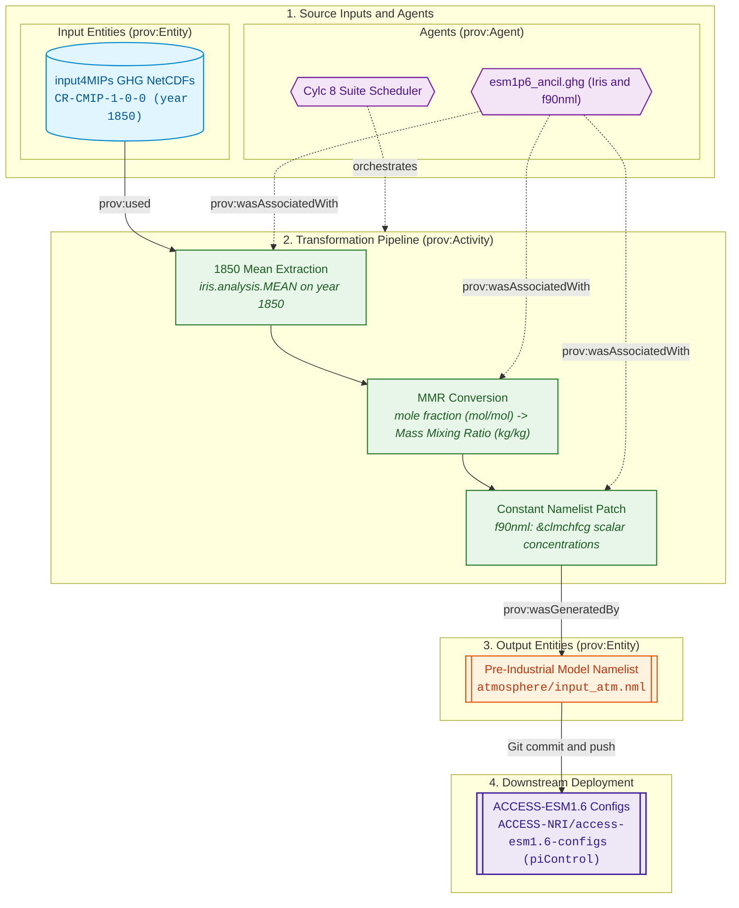
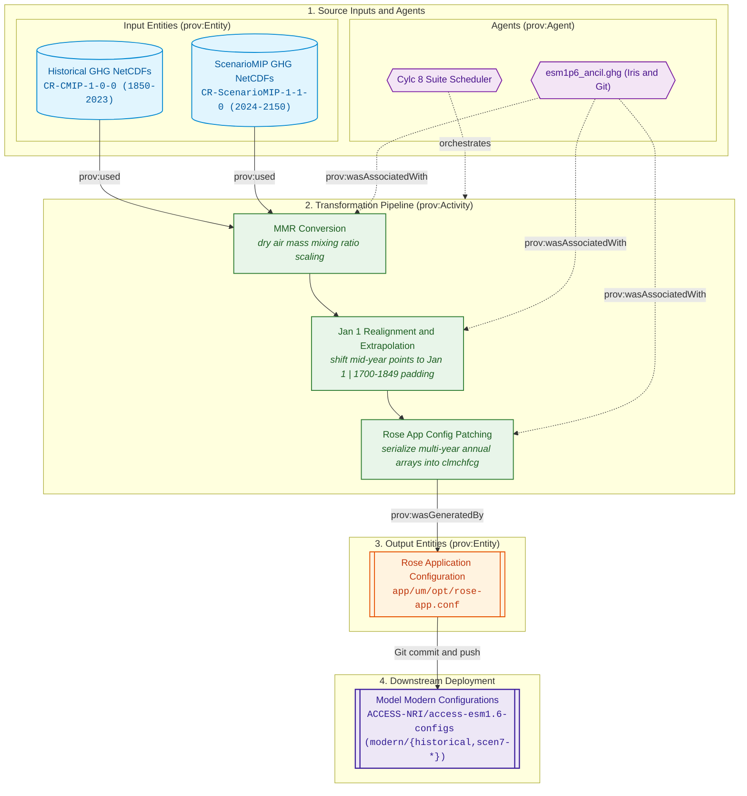

# Greenhouse Gases (GHG) Forcing Specifications

The Greenhouse Gas (GHG) forcing pipeline ingests CMIP7 global-mean annual surface volume mixing ratios for 9 primary greenhouse gas species, converts them into mass mixing ratios (MMR), linearly interpolates values to January 1, and directly updates the model climate forcing namelist (`&clmchfcg`) in the downstream [ACCESS-ESM1.6 configurations](https://github.com/ACCESS-NRI/access-esm1.6-configs).

---

## Physical Domain & Scientific Scope

* **Species Modeled (9 gases):** Carbon Dioxide (`co2`), Methane (`ch4`), Nitrous Oxide (`n2o`), CFC-11 (`cfc11`), CFC-12 (`cfc12`), CFC-113 (`cfc113`), HCFC-22 (`hcfc22`), HFC-125 (`hfc125`), and HFC-134a (`hfc134a`).
* **Source Representation:** Global-mean annual timeseries (`yr`, `gm`) distributed in NetCDF format via input4MIPs.
* **Target Representation:** In-memory array of mass mixing ratios written into the Unified Model `&clmchfcg` namelist group, dimensioned `(nyears, 11)` across the 11 UM radiatively active gases.
* **Temporal Interpolation Scheme:** CMIP7 source concentrations represent annual means centered at mid-year. Because the UM radiation scheme linearly interpolates between specified annual control points, mid-year values are interpolated to January 1 ($t_{Jan1} = 0.5 \times (t_{yr} + t_{yr+1})$) so that UM monthly integration reproduces the annual means.

---

## Provenance & Dataflow Architecture

The greenhouse gas pipeline follows the W3C PROV framework, ingesting global-mean volume mixing ratios, realigning temporal coordinates, and synchronizing configuration patches into the downstream model repository. The architecture separates by experiment requirements:
* **Pre-Industrial Control (`PI`):** Extracts 1850 single-year scalar concentrations, converts them to mass mixing ratios (MMR), and patches model coupling namelists. See [Pre-Industrial Experiment Dataflow Architecture](#pi-dataflow).
* **Historical (`HI`) & ScenarioMIP (`SM`):** Realigns multi-century time series to January 1, extends backwards to 1700, and injects annual time-series arrays into Rose app configurations. See [Historical & ScenarioMIP Dataflow Architecture](#hi-dataflow).

---

## Controlling Suite Switches

The execution, scenario extension, and downstream configuration synchronization for greenhouse gases are controlled by parameters in [`rose-suite.conf`](../configuration/suite_objects.md):

* **Master Activation Switch:** `ANCIL_CREATE_GHG = true`  
  When set to `false`, greenhouse gas processing and associated namelist patching tasks are excluded from the execution graph.
* **Experiment Activation:** Governed by `USE_EXP['PI']`, `USE_EXP['HI']`, and `USE_EXP['SM']`.
* **Scenario Extension Controls (`EXTEND_SM_GHG`):**  
  Controls whether future pathways concatenate extension files (2101–2200) to cover up to 2150 with `--ext`:
    * `'h': True` (Extended to 2150 via `CR-h-ext-1-1-0`)
    * `'hl': False` (Bounded to 2100)
    * `'m': False` (Bounded to 2100)
    * `'vl': True` (Extended to 2150 via `CR-vl-ext-1-1-0`)
* **Downstream Configuration Branching:**  
  Greenhouse gases directly patch the `&clmchfcg` namelist in clones of `access-esm1.6-configs`. The source branches are configured via `GIT_CONFIG_BRANCH_PRE` (`dev` for PI/HI, `pl` for SM) and suffixes `GIT_CONFIG_BRANCH_SUF` (`piControl`, `historical`) / `GIT_SM_CONFIG_BRANCH_SUF` (`scen7-<scen>`). Remote push is gated by `GIT_CONFIG_BRANCH_PUSH = false`.
* **Reference:** See [Suite Configuration & Parameters Reference](../configuration/suite_objects.md) for full object definitions.

---

## 1. Pre-Industrial Experiment (PI)

<a id="pi-dataflow"></a>
### Dataflow Architecture

The pre-industrial GHG pipeline extracts 1850 perpetual concentrations, converts volume mixing ratios to mass mixing ratios (MMR), and patches the model namelist:





### `PI_ancil_ghg`

* **1. Description & Purpose:**  
  Extracts perpetual pre-industrial (year 1850) global-mean greenhouse gas concentrations for the 9 species from the CMIP7 historical dataset, converts them to mass mixing ratios, and patches the `&clmchfcg` namelist in the `pre-industrial` configuration branch.
* **2. CLI Arguments Passed:**  
  ```bash
  python -m esm1p6_ancil.ghg.cmip7_PI_ghg_generate \
      --ancil-target-dirname "${VAR.ANCIL_TARGET_PATH}" \
      # Current: "/g/data/${PROJECT}/${USER}/CMIP7/esm1p6_ancil/$(isodatetime -f CCYY.MM.DD)"
      --cmip7-source-data-dirname "${VAR.CMIP7_SOURCE_PATH}" \
      # Current: "/g/data/qv56/replicas/input4MIPs/CMIP7"
      --esm15-inputs-dirname "${VAR.ESM15_INPUTS_PATH}" \
      # Current: "/g/data/vk83/configurations/inputs/access-esm1p5"
      --dataset-version "${CMIP7_GHG_VERSION}" \
      # Current: "CR-CMIP-1-0-0"
      --dataset-vdate "${CMIP7_GHG_VDATE}" \
      # Current: "v20250228"
      --dataset-date-range "${CMIP7_GHG_DATE_RANGE}"
      # Current: "1750-2022"
  ```
* **3. Input4MIPs Versions & Temporal Metadata:**  
    * **Dataset Version:** `${CMIP7_GHG_VERSION}` (`CR-CMIP-1-0-0`)
    * **Version Date (`vdate`):** `${CMIP7_GHG_VDATE}` (`v20250228`)
    * **Input Date Range:** `${CMIP7_GHG_DATE_RANGE}` (`1750-2022`)
    * **Extracted Year:** `1850`
* **4. Input4MIPs Directory Path & Filenames:**  
    * **Directory Path:** `${VAR.CMIP7_SOURCE_PATH}/CMIP/CR/${CMIP7_GHG_VERSION}/atmos/yr/{ghg}/gm/${CMIP7_GHG_VDATE}/`  
      *(Evaluated: `/g/data/qv56/replicas/input4MIPs/CMIP7/CMIP/CR/CR-CMIP-1-0-0/atmos/yr/{ghg}/gm/v20250228/`)*
    * **Filenames (9 gases):** `{ghg}_input4MIPs_GHGConcentrations_CMIP_${CMIP7_GHG_VERSION}_gm_${CMIP7_GHG_DATE_RANGE}.nc`
* **5. Python Scripts & Functions:**  
    * **Main Script / Entrypoint:** `esm1p6_ancil.ghg.cmip7_PI_ghg_generate`
    * **Key Functions Called:** `load_cmip7_ghg_point_mmr`, `cmip7_ghg_mmr`, `cmip7_scale`, `cmip7_pro_greg_date_constraint_from_years`, `cmip7_ghg_update_namelists_file`, `format_namelist`
    * **Shared Libraries:** `iris`, `cftime`, `numpy`, `f90nml`
* **6. Function-Level Cube Transformations & Constraints:**  
    * **Input Cubes & Coordinates:** 1D NetCDF cubes loaded via `iris.load_cube` per gas species with 1D Proleptic Gregorian `time` coordinate. Validates attribute `assert ghg == cube.metadata.attributes["variable_id"]`.
    * **Constraints Applied:** Date constraint `cmip7_pro_greg_date_constraint_from_years(1850, 1850)` filtering point `cftime.DatetimeProlepticGregorian(1850, 1, 1) <= cell.point <= cftime.DatetimeProlepticGregorian(1850, 12, 31)`.
    * **Coordinate Bounds & Manipulation:** Single annual point extracted without bounds. Scaled from volume mixing ratio (parts per volume) to mass mixing ratio via molar mass ratios:
    $$\text{MMR} = \text{VMR} \times \frac{M_{\text{gas}}}{M_{\text{air}}}$$
    * **Created / Output Cubes:** Scalar float values assembled into an 11-species row vector passed to `cmip7_ghg_update_namelists_file`.
* **7. Produced File Versions & Date Ranges:**  
  `None (Direct namelist generation)`. Represents perpetual year 1850 conditions.
* **8. Produced File Directory Paths & Filenames:**  
  `None`. No `.anc` or binary data files created.
* **9. Namelist File & Variable Updates:**  
    * **Target File:** `${GIT_PI_CONFIG_DIR}/atmosphere/namelists`
    * **Namelist Group:** `&clmchfcg`
    * **Variables Updated:**
    ```fortran
    l_clmchfcg = .TRUE.
    clim_fcg_nyears = 1, 1, 1, 1, 1, 1, 1, 1, 1, 1, 1
    clim_fcg_years = 1850
    clim_fcg_levls = <1850 MMR values for 11 species>
    clim_fcg_rates = -32768.0
    ```

---

## 2. Historical Experiment (HI)

<a id="hi-dataflow"></a>
### Dataflow Architecture

The historical and ScenarioMIP GHG pipelines realign multi-species time series to January 1, extrapolate backward to 1700, and serialize multi-year arrays into the Rose application configuration:





### `HI_ancil_ghg`

* **1. Description & Purpose:**  
  Reads CMIP7 historical annual global-mean surface concentrations for the 9 GHG species from 1750 to 2022, converts volume mixing ratios to mass mixing ratios, linearly interpolates values to January 1 across the model timeframe 1850–2024, and patches the `&clmchfcg` namelist in the `historical` configuration branch.
* **2. CLI Arguments Passed:**  
  ```bash
  python -m esm1p6_ancil.ghg.cmip7_HI_ghg_generate \
      --ancil-target-dirname "${VAR.ANCIL_TARGET_PATH}" \
      # Current: "/g/data/${PROJECT}/${USER}/CMIP7/esm1p6_ancil/$(isodatetime -f CCYY.MM.DD)"
      --cmip7-source-data-dirname "${VAR.CMIP7_SOURCE_PATH}" \
      # Current: "/g/data/qv56/replicas/input4MIPs/CMIP7"
      --esm15-inputs-dirname "${VAR.ESM15_INPUTS_PATH}" \
      # Current: "/g/data/vk83/configurations/inputs/access-esm1p5"
      --dataset-version "${CMIP7_GHG_VERSION}" \
      # Current: "CR-CMIP-1-0-0"
      --dataset-vdate "${CMIP7_GHG_VDATE}" \
      # Current: "v20250228"
      --dataset-date-range "${CMIP7_GHG_DATE_RANGE}"
      # Current: "1750-2022"
  ```
* **3. Input4MIPs Versions & Temporal Metadata:**  
    * **Dataset Version:** `${CMIP7_GHG_VERSION}` (`CR-CMIP-1-0-0`)
    * **Version Date (`vdate`):** `${CMIP7_GHG_VDATE}` (`v20250228`)
    * **Input Date Range:** `${CMIP7_GHG_DATE_RANGE}` (`1750-2022`)
    * **Processed Model Timeline:** `1850-2024` (175 annual points)
* **4. Input4MIPs Directory Path & Filenames:**  
    * **Directory Path:** `${VAR.CMIP7_SOURCE_PATH}/CMIP/CR/${CMIP7_GHG_VERSION}/atmos/yr/{ghg}/gm/${CMIP7_GHG_VDATE}/`  
      *(Evaluated: `/g/data/qv56/replicas/input4MIPs/CMIP7/CMIP/CR/CR-CMIP-1-0-0/atmos/yr/{ghg}/gm/v20250228/`)*
    * **Filenames (9 gases):** `{ghg}_input4MIPs_GHGConcentrations_CMIP_${CMIP7_GHG_VERSION}_gm_${CMIP7_GHG_DATE_RANGE}.nc`
* **5. Python Scripts & Functions:**  
    * **Main Script / Entrypoint:** `esm1p6_ancil.ghg.cmip7_HI_ghg_generate`
    * **Key Functions Called:** `load_cmip7_ghg_series_mmr`, `cmip7_ghg_update_namelists_file`, `cmip7_ghg_namelist_str`, `cmip7_ghg_mmr`, `cmip7_scale`, `cmip7_pro_greg_date_constraint_from_years`, `read_namelists_lines_up_to`, `format_namelist`
    * **Shared Libraries:** `iris`, `cftime`, `numpy`, `f90nml`
* **6. Function-Level Cube Transformations & Constraints:**  
    * **Input Cubes & Coordinates:** 1D NetCDF cubes loaded via `iris.load_cube` per gas species, with `time` coordinate defined on the Proleptic Gregorian calendar. Validates attribute `assert ghg == full_cube.metadata.attributes["variable_id"]`.
    * **Constraints Applied:**
        * Date range constraint: `cmip7_pro_greg_date_constraint_from_years(1850, 2024)` filtering points within `1850-01-01` to `2024-12-31`.
        * Annual point constraint: `cmip7_pro_greg_date_constraint_from_years(year, year)` in extraction loop.
    * **Coordinate Bounds & Manipulation:**
        * Mid-year values interpolated to Jan 1 (`0.5 * (val[:-1] + val[1:])`).
        * Backwards extrapolation for first year (`beg_year_cube.data[0] = val[0] + 0.5 * (val[0] - val[1])`), setting time point to January 1, 00:00:00.
        * Time bounds dropped completely (`beg_year_cube_time.bounds = None`, `new_cube_time.bounds = None`).
        * Concatenates backwards-extrapolated cube with main cube via `iris.cube.CubeList.concatenate_cube()` after `iris.util.unify_time_units` and `iris.util.equalise_attributes`.
    * **Created / Output Cubes:** Produces sliced scalar `year_cube` instances converted via `cmip7_ghg_mmr` into mass mixing ratio floating point series passed directly to namelist construction.
* **7. Produced File Versions & Date Ranges:**  
  `None (Direct namelist generation)`. Temporal coverage encoded into namelist: 1850–2024 (175 annual points).
* **8. Produced File Directory Paths & Filenames:**  
  `None`. No `.anc` or binary data files created.
* **9. Namelist File & Variable Updates:**  
    * **Target File:** `${GIT_HI_CONFIG_DIR}/atmosphere/namelists`
    * **Namelist Group:** `&clmchfcg`
    * **Variables Updated:**
    ```fortran
    l_clmchfcg = .TRUE.
    clim_fcg_nyears = 175, 175, 175, 175, 175, 175, 175, 175, 175, 175, 175
    clim_fcg_years = 1850..2024
    clim_fcg_levls = <175 rows of MMR values for 11 species>
    clim_fcg_rates = -32768.0
    ```

---

## 3. ScenarioMIP Experiment (SM)

> [!NOTE]
> **Dataflow Architecture:** ScenarioMIP greenhouse gas processing follows the same time-series dataflow architecture as the [Historical Experiment (HI)](#hi-dataflow).

### `SM_{h,hl,m,vl}_ancil_ghg`

Tasks generate future greenhouse gas concentration timeseries across the four ScenarioMIP pathways (`h`, `hl`, `m`, `vl`). Extension to 2150 is controlled per scenario via `EXTEND_SM_GHG[SCEN]`.

=== "Scenario h (High)"
    * **1. Description & Purpose:**  
      Reads ScenarioMIP high-emissions (`h`) greenhouse gas concentrations, concatenates extension dataset chunks (2101–2200) when `EXTEND_SM_GHG['h']` is active (`--ext`) to cover the timeline to 2150, extrapolates annual values to January 1, and patches the `&clmchfcg` namelist in the `gen-scen7-h-<UUID>` branch.
    * **2. CLI Arguments Passed:**  
      ```bash
      python -m esm1p6_ancil.ghg.cmip7_SM_ghg_generate \
          --ancil-target-dirname "${VAR.ANCIL_TARGET_PATH}" \
          # Current: "/g/data/${PROJECT}/${USER}/CMIP7/esm1p6_ancil/$(isodatetime -f CCYY.MM.DD)"
          --cmip7-source-data-dirname "${VAR.CMIP7_SOURCE_PATH}" \
          # Current: "/g/data/qv56/replicas/input4MIPs/CMIP7"
          --esm15-inputs-dirname "${VAR.ESM15_INPUTS_PATH}" \
          # Current: "/g/data/vk83/configurations/inputs/access-esm1p5"
          --dataset-version "${CMIP7_SM_GHG_VERSION[SCEN]}" \
          # Current: "CR-h-1-1-0"
          --dataset-vdate "${CMIP7_SM_GHG_VDATE[SCEN]}" \
          # Current: "v20260327"
          --dataset-date-range "${CMIP7_SM_GHG_DATE_RANGE}" \
          # Current: "2022-2100"
          --ext \
          --dataset-ext-version "${CMIP7_SM_EXT_GHG_VERSION[SCEN]}" \
          # Current: "CR-h-ext-1-1-0"
          --dataset-ext-vdate "${CMIP7_SM_EXT_GHG_VDATE[SCEN]}" \
          # Current: "v20260327"
          --dataset-ext-date-range "${CMIP7_SM_EXT_GHG_DATE_RANGE}"
          # Current: "2101-2200"
      ```
    * **3. Input4MIPs Versions & Temporal Metadata:**  
        * Base Dataset: `${CMIP7_SM_GHG_VERSION['h']}` (`CR-h-1-1-0`), `${CMIP7_SM_GHG_VDATE['h']}` (`v20260327`), Date Range: `${CMIP7_SM_GHG_DATE_RANGE}` (`2022-2100`)
        * Extension Dataset: `${CMIP7_SM_EXT_GHG_VERSION['h']}` (`CR-h-ext-1-1-0`), `${CMIP7_SM_EXT_GHG_VDATE['h']}` (`v20260327`), Date Range: `${CMIP7_SM_EXT_GHG_DATE_RANGE}` (`2101-2200`)
        * Model Target Range: `2022-2150` (129 annual values)
    * **4. Input4MIPs Directory Path & Filenames:**  
        * Base: `${VAR.CMIP7_SOURCE_PATH}/ScenarioMIP/CR/${CMIP7_SM_GHG_VERSION['h']}/atmos/yr/{ghg}/gm/${CMIP7_SM_GHG_VDATE['h']}/{ghg}_input4MIPs_GHGConcentrations_ScenarioMIP_${CMIP7_SM_GHG_VERSION['h']}_gm_${CMIP7_SM_GHG_DATE_RANGE}.nc`
        * Extension: `${VAR.CMIP7_SOURCE_PATH}/ScenarioMIP/CR/${CMIP7_SM_EXT_GHG_VERSION['h']}/atmos/yr/{ghg}/gm/${CMIP7_SM_EXT_GHG_VDATE['h']}/{ghg}_input4MIPs_GHGConcentrations_ScenarioMIP_${CMIP7_SM_EXT_GHG_VERSION['h']}_gm_${CMIP7_SM_EXT_GHG_DATE_RANGE}.nc`
    * **5. Python Scripts & Functions:**  
        * **Main Script / Entrypoint:** `esm1p6_ancil.ghg.cmip7_SM_ghg_generate`
        * **Key Functions Called:** `load_cmip7_ghg_series_mmr`, `cmip7_ghg_update_namelists_file`, `cmip7_ghg_namelist_str`, `cmip7_ghg_mmr`, `cmip7_pro_greg_date_constraint_from_years`, `iris.cube.CubeList.concatenate_cube`, `iris.util.equalise_attributes`, `iris.util.unify_time_units`
    * **6. Function-Level Cube Transformations & Constraints:**  
        * **Input Cubes:** Base scenario cube `full_cube` (2022–2100) and extension chunk `ext_cube` (2101–2200) loaded via `iris.load_cube`.
        * **Constraints Applied:** Concatenation via `CubeList([full_cube, ext_cube]).concatenate_cube()` after attribute equalization. Date range constraint `cmip7_pro_greg_date_constraint_from_years(2022, 2150)` extracts the 2022–2150 timeline.
        * **Coordinate Bounds & Manipulation:** Linear interpolation to Jan 1 (`0.5 * (full[:-1] + full[1:])`), final year forward extrapolation (`full[-1] + 0.5 * (full[-1] - full[-2])`), time bounds cleared (`bounds = None`), time points assigned Jan 1 of each year.
        * **Created / Output Cubes:** Sliced annual `year_cube` instances converted via `cmip7_ghg_mmr` to MMR series for namelist injection.
    * **7. Produced File Versions & Date Ranges:**  
      `None (Direct namelist generation)`. Temporal coverage: 2022–2150 (129 annual values).
    * **8. Produced File Directory Paths & Filenames:**  
      `None`.
    * **9. Namelist File & Variable Updates:**  
        * **Target File:** `${GIT_SM_h_CONFIG_DIR}/atmosphere/namelists`
        * **Namelist Group:** `&clmchfcg`
        * **Variables Updated:** `l_clmchfcg = .TRUE.`, `clim_fcg_nyears = 129`, `clim_fcg_years = 2022..2150`, `clim_fcg_levls`, `clim_fcg_rates = -32768.0`.

=== "Scenario hl (High-Low)"
    * **Dataset Versions:** Base `CR-hl-1-1-0` (`v20260327`, `2022-2100`); Extension `CR-hl-ext-1-1-0` (`v20260327`, `2101-2200`).
    * **Script & Invocation:** `esm1p6_ancil.ghg.cmip7_SM_ghg_generate` with `--dataset-version "CR-hl-1-1-0"`.
    * **Target Branch & Namelist:** `${GIT_SM_hl_CONFIG_DIR}/atmosphere/namelists` (`&clmchfcg`).

=== "Scenario m (Medium)"
    * **Dataset Versions:** Base `CR-m-1-1-0` (`v20260327`, `2022-2100`); Extension `CR-m-ext-1-1-0` (`v20260327`, `2101-2200`).
    * **Script & Invocation:** `esm1p6_ancil.ghg.cmip7_SM_ghg_generate` with `--dataset-version "CR-m-1-1-0"`.
    * **Target Branch & Namelist:** `${GIT_SM_m_CONFIG_DIR}/atmosphere/namelists` (`&clmchfcg`).

=== "Scenario vl (Very Low)"
    * **Dataset Versions:** Base `CR-vl-1-1-0` (`v20260327`, `2022-2100`); Extension `CR-vl-ext-1-1-0` (`v20260327`, `2101-2200`).
    * **Script & Invocation:** `esm1p6_ancil.ghg.cmip7_SM_ghg_generate` with `--dataset-version "CR-vl-1-1-0"`.
    * **Target Branch & Namelist:** `${GIT_SM_vl_CONFIG_DIR}/atmosphere/namelists` (`&clmchfcg`).
