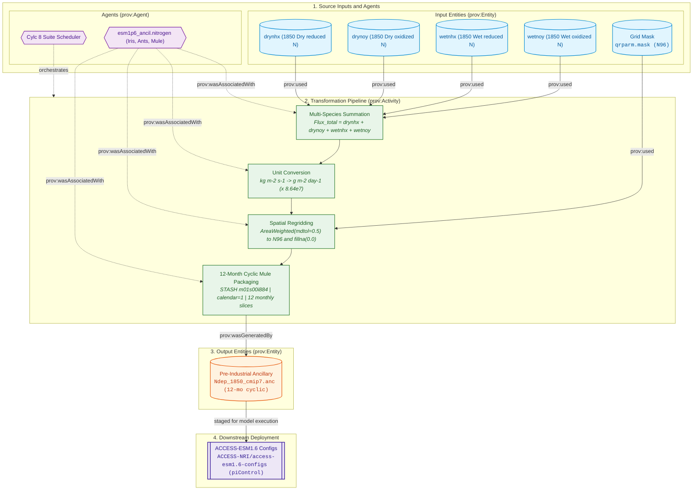
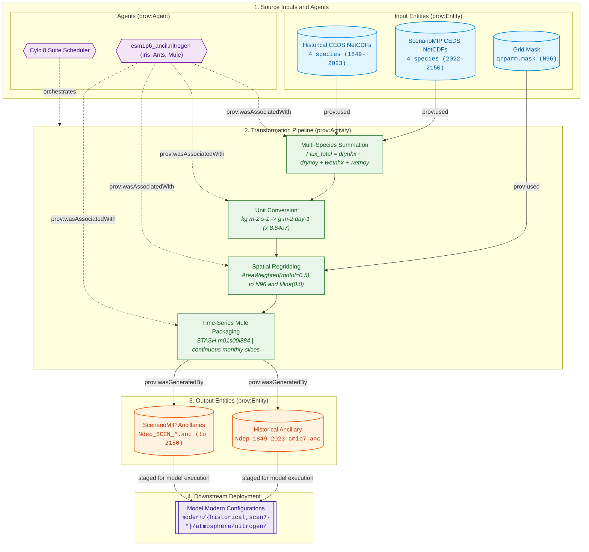

# Nitrogen Deposition Forcing Specifications

The Nitrogen deposition pipeline aggregates 4 atmospheric reactive nitrogen deposition flux species from CMIP7, converts units to $\text{g}\,\text{m}^{-2}\,\text{day}^{-1}$, regrids conservatively to the `global.N96` grid, and outputs binary Unified Model ancillary files (`.anc`) for the CABLE / CASA-CNP terrestrial biogeochemistry scheme in ACCESS-ESM1.6.

---

## Physical Domain & Scientific Scope

* **Species Aggregated (4 fluxes):**
  1. Dry deposition of reduced nitrogen (`drynhx`, $\text{NH}_x$)
  2. Dry deposition of oxidized nitrogen (`drynoy`, $\text{NO}_y$)
  3. Wet deposition of reduced nitrogen (`wetnhx`, $\text{NH}_x$)
  4. Wet deposition of oxidized nitrogen (`wetnoy`, $\text{NO}_y$)
* **Total Deposition Calculation:**
  $$\text{Flux}_{\text{total}} = \text{drynhx} + \text{drynoy} + \text{wetnhx} + \text{wetnoy}$$
* **Unit Conversion:**
  Converted from standard CMIP7 flux units ($\text{kg}\,\text{m}^{-2}\,\text{s}^{-1}$) to Unified Model land biogeochemistry units ($\text{g}\,\text{m}^{-2}\,\text{day}^{-1}$) via:
  $$\text{Flux} \left[\text{g}\,\text{m}^{-2}\,\text{day}^{-1}\right] = \text{Flux} \left[\text{kg}\,\text{m}^{-2}\,\text{s}^{-1}\right] \times 1000.0 \times 86400.0$$
* **Target STASH Item:** `m01s00i884` (NITROGEN DEPOSITION).
* **Grid & Interpolation:** Conservative area-weighted regridding (`AreaWeighted(mdtol=0.5)`) using `esm_grid_mask_cube(args)`, with missing data filled to 0.0.

---

## Provenance & Dataflow Architecture

The nitrogen deposition pipeline aggregates four distinct reactive nitrogen deposition species into a unified terrestrial biogeochemistry forcing, converting units, regridding onto the N96 grid, and packing via Mule. The pipeline separates by experiment:
* **Pre-Industrial Control (`PI`):** Generates a 12-month perpetual cyclic ancillary (`Ndep_1850_cmip7.anc`). See [Pre-Industrial Experiment Dataflow Architecture](#pi-dataflow).
* **Historical (`HI`) & ScenarioMIP (`SM`):** Generates continuous monthly multi-decadal time-series ancillaries (`Ndep_1849_2023_cmip7.anc` and scenario files extending to 2150). See [Historical & ScenarioMIP Dataflow Architecture](#hi-dataflow).

---

## Controlling Suite Switches

The execution, experiment inclusion, and temporal extension for reactive nitrogen deposition are controlled by parameters in [`rose-suite.conf`](../configuration/suite_objects.md):

* **Master Activation Switch:** `ANCIL_CREATE_NITROGEN = true`  
  When set to `false`, all nitrogen deposition processing tasks are excluded from the execution graph.
* **Experiment Activation:** Governed by `USE_EXP['PI']`, `USE_EXP['HI']`, and `USE_EXP['SM']`.
* **Scenario Extension Controls (`EXTEND_SM_NITROGEN`):**  
  Controls whether future projection pathways pass `--ext` to extend coverage through 2150:
    * `'h': True` (Extended to 2150, producing `${ESM_SM_EXT_NITROGEN_SAVE_FILENAME['h']}`)
    * `'hl': True` (Extended to 2150, producing `${ESM_SM_EXT_NITROGEN_SAVE_FILENAME['hl']}`)
    * `'m': True` (Extended to 2150, producing `${ESM_SM_EXT_NITROGEN_SAVE_FILENAME['m']}`)
    * `'vl': True` (Extended to 2150, producing `${ESM_SM_EXT_NITROGEN_SAVE_FILENAME['vl']}`)
* **Reference:** See [Suite Configuration & Parameters Reference](../configuration/suite_objects.md) for full object declarations.

---

## 1. Pre-Industrial Experiment (PI)

<a id="pi-dataflow"></a>
### Dataflow Architecture

The pre-industrial nitrogen deposition workflow sums the four reactive nitrogen species for 1850, regrids conservatively to N96, and packages into a 12-month cyclic ancillary:





### `PI_ancil_nitrogen`

* **1. Description & Purpose:**  
  Generates cyclic 1850 monthly reactive nitrogen deposition ancillaries for the pre-industrial control run (`${ESM_PI_NITROGEN_SAVE_FILENAME}` / `Ndep_1850_cmip7.anc`).
* **2. CLI Arguments Passed:**  
  ```bash
  python -m esm1p6_ancil.nitrogen.cmip7_PI_nitrogen_generate \
      --ancil-target-dirname "${VAR.ANCIL_TARGET_PATH}" \
      # Current: "/g/data/${PROJECT}/${USER}/CMIP7/esm1p6_ancil/$(isodatetime -f CCYY.MM.DD)"
      --cmip7-source-data-dirname "${VAR.CMIP7_SOURCE_PATH}" \
      # Current: "/g/data/qv56/replicas/input4MIPs/CMIP7"
      --esm15-inputs-dirname "${VAR.ESM15_INPUTS_PATH}" \
      # Current: "/g/data/vk83/configurations/inputs/access-esm1p5"
      --esm-grid-rel-dirname "${ESM_GRID_DIRNAME}" \
      # Current: "global.N96"
      --esm15-grid-version "${ESM15_GRID_VERSION}" \
      # Current: "2020.05.19"
      --dataset-version "${CMIP7_NITROGEN_VERSION}" \
      # Current: "FZJ-CMIP-nitrogen-1-2"
      --dataset-vdate "${CMIP7_NITROGEN_VDATE}" \
      # Current: "v20251025"
      --dataset-date-range "${CMIP7_PI_NITROGEN_DATE_RANGE}" \
      # Current: "185001-185012"
      --save-filename "${ESM_PI_NITROGEN_SAVE_FILENAME}"
      # Current: "Ndep_1850_cmip7.anc"
  ```
* **3. Input4MIPs Versions & Temporal Metadata:**  
    * **Dataset Version:** `${CMIP7_NITROGEN_VERSION}` (`FZJ-CMIP-nitrogen-1-2`)
    * **Version Date (`vdate`):** `${CMIP7_NITROGEN_VDATE}` (`v20251025`)
    * **Input Date Range:** `${CMIP7_PI_NITROGEN_DATE_RANGE}` (`185001-185012`, 12 monthly slices)
* **4. Input4MIPs Directory Path & Filenames:**  
    * **Directory Path:** `${VAR.CMIP7_SOURCE_PATH}/CMIP/FZJ/${CMIP7_NITROGEN_VERSION}/atmos/mon/{species}/gn/${CMIP7_NITROGEN_VDATE}/`  
      *(Evaluated: `/g/data/qv56/replicas/input4MIPs/CMIP7/CMIP/FZJ/FZJ-CMIP-nitrogen-1-2/atmos/mon/{species}/gn/v20251025/`)*
    * **Filenames (4 species):** `{species}_input4MIPs_surfaceFluxes_CMIP_${CMIP7_NITROGEN_VERSION}_gn_${CMIP7_PI_NITROGEN_DATE_RANGE}.nc`
* **5. Python Scripts & Functions:**  
    * **Main Script / Entrypoint:** `esm1p6_ancil.nitrogen.cmip7_PI_nitrogen_generate`
    * **Key Functions Called:** `load_cmip7_nitrogen`, `regrid_cmip7_nitrogen`, `save_cmip7_nitrogen`, `fix_coords`, `esm_grid_mask_cube`, `save_ancil`
    * **Shared Libraries:** `iris`, `mule`, `ants`, `numpy`
* **6. Function-Level Cube Transformations & Constraints:**  
    * **Input Cubes & Coordinates:** Four 3D NetCDF cubes loaded into an `iris.cube.CubeList` representing `drynhx`, `drynoy`, `wetnhx`, and `wetnoy` on monthly time points.
    * **Constraints Applied:** Name constraints corresponding to standard CF names for nitrogen fluxes; attributes equalized via `equalise_attributes(nitrogen_cubes)`.
    * **Coordinate Bounds & Manipulation:**
        * Cubes summed elementwise into a total flux cube.
        * Units converted from `kg m-2 s-1` to `g m-2 day-1` via `cube_tot.convert_units("g m-2 day-1")`.
        * Coordinates standardized via `fix_coords(args, cube)`.
        * Regridded to `global.N96` using `AreaWeighted(mdtol=0.5)` against `esm_grid_mask_cube(args)`.
        * Missing values masked and zeroed (`data.filled(0.0)`).
        * STASH attribute assigned: `m01s00i884`.
    * **Created / Output Cubes:** Formats final 3D cube `(time: 12, lat: 144, lon: 192)` passed to `save_ancil`.
* **7. Produced File Versions & Date Ranges:**  
    * **Temporal Coverage:** `185001-185012` (12 monthly slices)
    * **Calendar:** 365-day (NoLeap) calendar alignment
    * **STASH Code:** `m01s00i884`
* **8. Produced File Directory Paths & Filenames:**  
    * **Output Directory:** `${VAR.ANCIL_TARGET_PATH}/modern/pre-industrial/atmosphere/nitrogen/${ESM_GRID_DIRNAME}/<ANCIL_TODAY>/`
    * **Output Filename:** `${ESM_PI_NITROGEN_SAVE_FILENAME}` (`Ndep_1850_cmip7.anc`)
* **9. Namelist File & Variable Updates:**  
  `None (Generates binary ancillary .anc file)`.

---

## 2. Historical Experiment (HI)

<a id="hi-dataflow"></a>
### Dataflow Architecture

The historical and ScenarioMIP nitrogen deposition pipelines sum multi-decadal flux fields across all 4 species, regrid to N96, and package continuous monthly time-series ancillaries:





### `HI_ancil_nitrogen`

* **1. Description & Purpose:**  
  Ingests monthly time-series nitrogen deposition fluxes from 1850 to 2022, pads timeline to span 1849–2023 for model spin-up/spin-down boundary compliance, regrids to N96, and produces `${ESM_HI_NITROGEN_SAVE_FILENAME}` (`Ndep_1849_2023_cmip7.anc`).
* **2. CLI Arguments Passed:**  
  ```bash
  python -m esm1p6_ancil.nitrogen.cmip7_HI_nitrogen_generate \
      --ancil-target-dirname "${VAR.ANCIL_TARGET_PATH}" \
      # Current: "/g/data/${PROJECT}/${USER}/CMIP7/esm1p6_ancil/$(isodatetime -f CCYY.MM.DD)"
      --cmip7-source-data-dirname "${VAR.CMIP7_SOURCE_PATH}" \
      # Current: "/g/data/qv56/replicas/input4MIPs/CMIP7"
      --esm15-inputs-dirname "${VAR.ESM15_INPUTS_PATH}" \
      # Current: "/g/data/vk83/configurations/inputs/access-esm1p5"
      --esm-grid-rel-dirname "${ESM_GRID_DIRNAME}" \
      # Current: "global.N96"
      --esm15-grid-version "${ESM15_GRID_VERSION}" \
      # Current: "2020.05.19"
      --dataset-version "${CMIP7_NITROGEN_VERSION}" \
      # Current: "FZJ-CMIP-nitrogen-1-2"
      --dataset-vdate "${CMIP7_NITROGEN_VDATE}" \
      # Current: "v20251025"
      --dataset-date-range "${CMIP7_HI_NITROGEN_DATE_RANGE}" \
      # Current: "185001-202212"
      --save-filename "${ESM_HI_NITROGEN_SAVE_FILENAME}"
      # Current: "Ndep_1849_2023_cmip7.anc"
  ```
* **3. Input4MIPs Versions & Temporal Metadata:**  
    * **Dataset Version:** `${CMIP7_NITROGEN_VERSION}` (`FZJ-CMIP-nitrogen-1-2`), `${CMIP7_NITROGEN_VDATE}` (`v20251025`), Range: `${CMIP7_HI_NITROGEN_DATE_RANGE}` (`185001-202212`).
    * **Processed Model Timeline:** `184901-202312` (175 years, 2100 monthly slices).
* **4. Input4MIPs Directory Path & Filenames:**  
    * **Path:** `${VAR.CMIP7_SOURCE_PATH}/CMIP/FZJ/${CMIP7_NITROGEN_VERSION}/atmos/mon/{species}/gn/${CMIP7_NITROGEN_VDATE}/`  
      *(Evaluated: `/g/data/qv56/replicas/input4MIPs/CMIP7/CMIP/FZJ/FZJ-CMIP-nitrogen-1-2/atmos/mon/{species}/gn/v20251025/`)*
    * **Filenames:** `{species}_input4MIPs_surfaceFluxes_CMIP_${CMIP7_NITROGEN_VERSION}_gn_${CMIP7_HI_NITROGEN_DATE_RANGE}.nc`
* **5. Python Scripts & Functions:** `esm1p6_ancil.nitrogen.cmip7_HI_nitrogen_generate`, `load_cmip7_nitrogen`, `regrid_cmip7_nitrogen`, `extend_years`, `save_cmip7_nitrogen`.
* **6. Cube Transformations:**
    * Aggregates 4 species, converts units to `g m-2 day-1`.
    * Prepends 1849 (repeating 1850) and appends 2023 (repeating 2022) via `extend_years` to satisfy UM padding requirements.
    * Regrids to N96 (`AreaWeighted(mdtol=0.5)`) and sets STASH `m01s00i884`.
* **7. Produced File:** `${ESM_HI_NITROGEN_SAVE_FILENAME}` (`Ndep_1849_2023_cmip7.anc`, 2100 monthly slices, 1849–2023).
* **8. Destination Path:** `${VAR.ANCIL_TARGET_PATH}/modern/historical/atmosphere/nitrogen/${ESM_GRID_DIRNAME}/<DATE>/${ESM_HI_NITROGEN_SAVE_FILENAME}`.
* **9. Namelist Updates:** `None (Generates binary ancillary .anc file)`.

---

## 3. ScenarioMIP Experiment (SM)

> [!NOTE]
> **Dataflow Architecture:** ScenarioMIP reactive nitrogen deposition processing follows the same time-series dataflow architecture as the [Historical Experiment (HI)](#hi-dataflow).

### `SM_{h,hl,m,vl}_ancil_nitrogen`

=== "Scenario h (High)"
    * **1. Description & Purpose:** Generates future projection nitrogen deposition ancillaries for scenario `h`. When `EXTEND_SM_NITROGEN['h']` is active (`--ext`), extends 2022–2100 data to 2150 by tiling the final year (2100) or applying pathway extensions, saving `${ESM_SM_EXT_NITROGEN_SAVE_FILENAME['h']}` (`Ndep_h_2022_2150_cmip7.anc`).
    * **2. CLI Arguments Passed:**
      ```bash
      python -m esm1p6_ancil.nitrogen.cmip7_SM_nitrogen_generate \
          --scenario "${SCEN}" \
          # Current: "h"
          --ancil-target-dirname "${VAR.ANCIL_TARGET_PATH}" \
          # Current: "/g/data/${PROJECT}/${USER}/CMIP7/esm1p6_ancil/$(isodatetime -f CCYY.MM.DD)"
          --cmip7-source-data-dirname "${VAR.CMIP7_SOURCE_PATH}" \
          # Current: "/g/data/qv56/replicas/input4MIPs/CMIP7"
          --esm15-inputs-dirname "${VAR.ESM15_INPUTS_PATH}" \
          # Current: "/g/data/vk83/configurations/inputs/access-esm1p5"
          --esm-grid-rel-dirname "${ESM_GRID_DIRNAME}" \
          # Current: "global.N96"
          --esm15-grid-version "${ESM15_GRID_VERSION}" \
          # Current: "2020.05.19"
          --dataset-version "${CMIP7_SM_NITROGEN_VERSION[SCEN]}" \
          # Current: "FZJ-CMIP-nitrogen-h-1-0"
          --dataset-vdate "${CMIP7_SM_NITROGEN_VDATE[SCEN]}" \
          # Current: "v20260409"
          --dataset-date-range "${CMIP7_SM_NITROGEN_DATE_RANGE}" \
          # Current: "202201-210012"
          --ext \
          --save-filename "${ESM_SM_EXT_NITROGEN_SAVE_FILENAME[SCEN]}"
          # Current: "Ndep_h_2022_2150_cmip7.anc"
      ```
    * **3. Input4MIPs Versions & Temporal Metadata:**  
        * Version: `${CMIP7_SM_NITROGEN_VERSION['h']}` (`FZJ-CMIP-nitrogen-h-1-0`), `${CMIP7_SM_NITROGEN_VDATE['h']}` (`v20260409`), Range: `${CMIP7_SM_NITROGEN_DATE_RANGE}` (`202201-210012`).
        * Target Coverage: `2022-2150` (1548 monthly slices).
    * **4. Input4MIPs Directory Path & Filenames:**  
        * `${VAR.CMIP7_SOURCE_PATH}/ScenarioMIP/FZJ/${CMIP7_SM_NITROGEN_VERSION['h']}/atmos/mon/{species}/gn/${CMIP7_SM_NITROGEN_VDATE['h']}/{species}_input4MIPs_surfaceFluxes_ScenarioMIP_${CMIP7_SM_NITROGEN_VERSION['h']}_gn_${CMIP7_SM_NITROGEN_DATE_RANGE}.nc`
    * **5. Scripts & Functions:** `esm1p6_ancil.nitrogen.cmip7_SM_nitrogen_generate`, `load_cmip7_sm_nitrogen`, `regrid_cmip7_nitrogen`, `extend_years`, `save_cmip7_nitrogen`.
    * **6. Cube Transformations:** Aggregates 4 nitrogen species, converts units, extends time axis to 2150 via `extend_years`, regrids conservatively to N96, and attaches STASH item 884.
    * **7. Produced File:** `${ESM_SM_EXT_NITROGEN_SAVE_FILENAME['h']}` (`Ndep_h_2022_2150_cmip7.anc`, 1548 monthly slices, 2022–2150).
    * **8. Destination Path:** `${VAR.ANCIL_TARGET_PATH}/modern/scen7-h/atmosphere/nitrogen/${ESM_GRID_DIRNAME}/<DATE>/${ESM_SM_EXT_NITROGEN_SAVE_FILENAME['h']}`.
    * **9. Namelist Updates:** `None (Generates binary ancillary .anc file)`.

=== "Scenario hl (High-Low)"
    * Dataset: `${CMIP7_SM_NITROGEN_VERSION['hl']}` (`FZJ-CMIP-nitrogen-hl-1-0`), `${CMIP7_SM_NITROGEN_VDATE['hl']}` (`v20260706`), `${CMIP7_SM_NITROGEN_DATE_RANGE}` (`202201-210012`).
    * Produces: `${ESM_SM_EXT_NITROGEN_SAVE_FILENAME['hl']}` (`Ndep_hl_2022_2150_cmip7.anc`, STASH 884, extended via `EXTEND_SM_NITROGEN['hl'] == True`).

=== "Scenario m (Medium)"
    * Dataset: `${CMIP7_SM_NITROGEN_VERSION['m']}` (`FZJ-CMIP-nitrogen-m-1-0`), `${CMIP7_SM_NITROGEN_VDATE['m']}` (`v20260706`), `${CMIP7_SM_NITROGEN_DATE_RANGE}` (`202201-210012`).
    * Produces: `${ESM_SM_EXT_NITROGEN_SAVE_FILENAME['m']}` (`Ndep_m_2022_2150_cmip7.anc`, STASH 884, extended via `EXTEND_SM_NITROGEN['m'] == True`).

=== "Scenario vl (Very Low)"
    * Dataset: `${CMIP7_SM_NITROGEN_VERSION['vl']}` (`FZJ-CMIP-nitrogen-vl-1-0`), `${CMIP7_SM_NITROGEN_VDATE['vl']}` (`v20260409`), `${CMIP7_SM_NITROGEN_DATE_RANGE}` (`202201-210012`).
    * Produces: `${ESM_SM_EXT_NITROGEN_SAVE_FILENAME['vl']}` (`Ndep_vl_2022_2150_cmip7.anc`, STASH 884, extended via `EXTEND_SM_NITROGEN['vl'] == True`).
