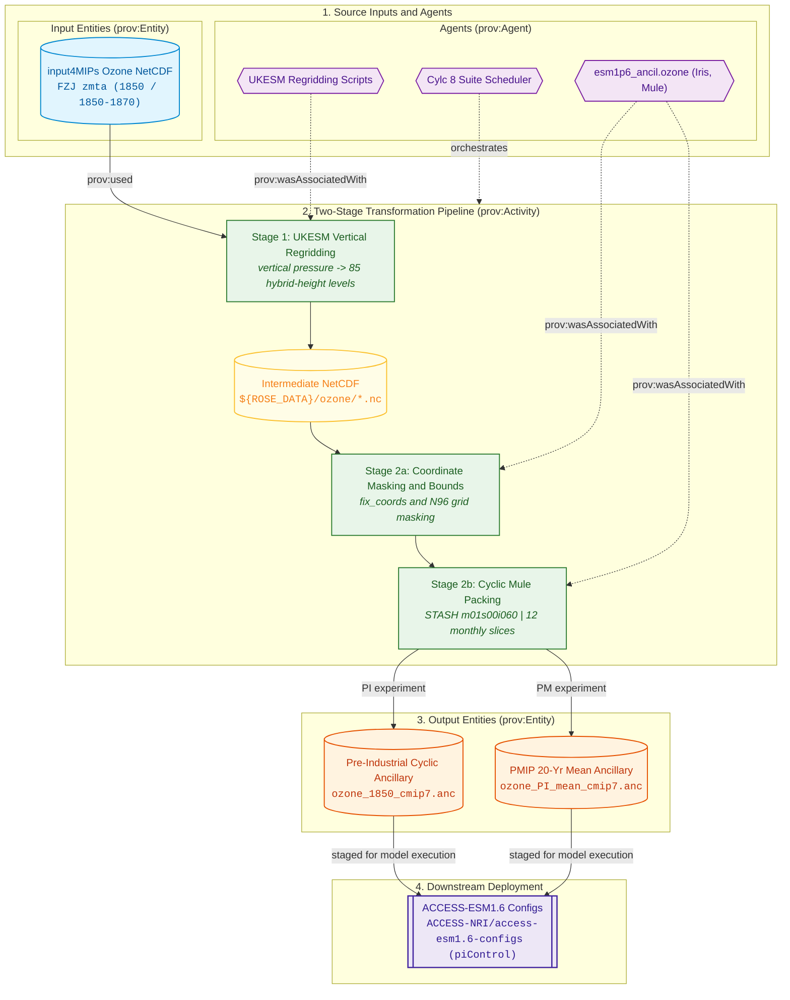
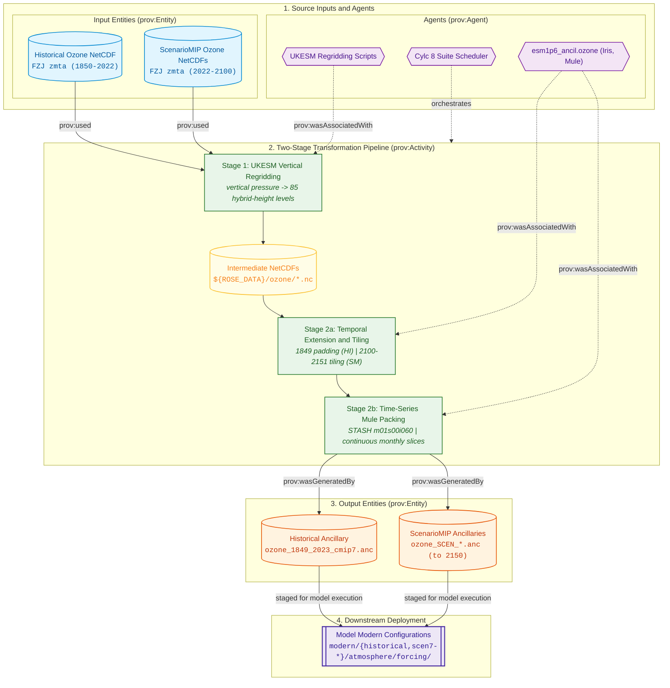

# Ozone Pipeline Forcing Specifications

The Ozone forcing pipeline ingests CMIP7 3D zonal-mean monthly atmospheric ozone concentrations (`zmta` / `mmro3`), regrids fields across 85 hybrid-height levels (matching UM L85), and manufactures 3D Unified Model binary ancillary files (`.anc`) for ACCESS-ESM1.6.

---

## Physical Domain & Scientific Scope

* **Target Variable:** Mass mixing ratio of ozone in air (`mmro3`). Target STASH item: `m01s00i060` (OZONE TRACER).
* **Two-Stage Workflow Architecture:**
    1. **UKESM Regridding Stage (`*_ukesm_ancil_ozone`):** Executes upstream Python scripts ported from `ancillary-file-science` (`3-port-cmip7-ozone-code-for-esm16`) to interpolate raw CMIP7 zonal-mean files (`atmos/mon/zmta`) in vertical pressure coordinates to the 85 UM model hybrid-height levels on the N96 horizontal grid. Outputs intermediate NetCDF files in `${ROSE_DATA}/ozone/`.
    2. **UM Ancillary Generation Stage (`*_ancil_ozone`):** Reads the intermediate NetCDF file, resolves coordinate bounds and iris datum conventions (`iris.FUTURE.datum_support = True`), handles boundary padding years, tiles extended timelines if `--ext` is specified, and writes binary `.anc` files via Mule.
* **Vertical Structure:** 85 terrain-following hybrid-height levels spanning the troposphere and stratosphere up to $\sim 85\text{ km}$.
* **Padding & Extension Rules:** UKESM intermediate ozone files include 1 padding year at each boundary (e.g. 1849 and 2023 for Historical; 2021 and 2101 for ScenarioMIP). In ScenarioMIP extension mode (`--ext`), `tile_constant_years` tiles constant year 2100 ozone to $2150 + 1$ (2151) to preserve model end-padding while eliminating concatenate overlaps.

---

## Provenance & Dataflow Architecture

The ozone pipeline follows the W3C PROV framework, coupling an upstream UKESM hybrid-height regridding engine with in-house Mule packaging to support perpetual 1850 cycles, PMIP multi-year averages, and multi-decadal time series:
* **Pre-Industrial (`PI`) & Paleoclimate (`PM`):** Packages 1850 perpetual cyclic (`ozone_1850_cmip7.anc`) and 1850–1870 20-year climatological mean (`ozone_PI_mean_cmip7.anc`) ancillaries. See [Pre-Industrial & Paleoclimate Dataflow Architecture](#pi-dataflow).
* **Historical (`HI`) & ScenarioMIP (`SM`):** Packages continuous monthly multi-decadal time-series ancillaries (`ozone_1849_2023_cmip7.anc` and scenario files extending to 2150). See [Historical & ScenarioMIP Dataflow Architecture](#hi-dataflow).

---

## Controlling Suite Switches

The execution, experiment inclusion, and temporal extension for the 3D ozone pipeline are controlled by parameters in [`rose-suite.conf`](../configuration/suite_objects.md):

* **Master Activation Switch:** `ANCIL_CREATE_OZONE = true`  
  When set to `false`, all UKESM regridding tasks and ancillary generation tasks are excluded from the Cylc task graph.
* **Experiment Activation:** Governed by `USE_EXP['PI']`, `USE_EXP['HI']`, `USE_EXP['SM']`, and `USE_EXP['PM']`.
* **Scenario Extension Controls (`EXTEND_SM_OZONE`):**  
  Controls whether future projection pathways pass `--ext` to tile 2100 concentrations to 2151:
    * `'h': True` (Produces `${ESM_SM_EXT_OZONE_SAVE_FILENAME['h']}`)
    * `'hl': True` (Produces `${ESM_SM_EXT_OZONE_SAVE_FILENAME['hl']}`)
    * `'m': True` (Produces `${ESM_SM_EXT_OZONE_SAVE_FILENAME['m']}`)
    * `'vl': True` (Produces `${ESM_SM_EXT_OZONE_SAVE_FILENAME['vl']}`)
* **Upstream Scripts Branching:** Clones the UKESM toolchain from `${GIT_ORG_URL}/${GIT_OZONE_SCRIPTS_REPO}.git` on branch `${GIT_OZONE_SCRIPTS_BRANCH}` (`3-port-cmip7-ozone-code-for-esm16`).
* **Reference:** See [Suite Configuration & Parameters Reference](../configuration/suite_objects.md) for full object declarations.

---

## 1. Pipeline Infrastructure Tasks

### `git_clone_ozone_scripts`
* **1. Description:** Clones the ozone processing scripts repository from GitHub (`${GIT_ORG_URL}/${GIT_OZONE_SCRIPTS_REPO}`) on branch `${GIT_OZONE_SCRIPTS_BRANCH}` into `${CYLC_WORKFLOW_SHARE_DIR}/git/`.
* **2. Execution:** Shell command `git clone --depth 1 -b ${GIT_OZONE_SCRIPTS_BRANCH} ${GIT_ORG_URL}/${GIT_OZONE_SCRIPTS_REPO}.git`.
* **7 & 8. Outputs:** Local repository clone in suite share directory.

### `install_ozone_scripts`
* **1. Description:** Installs dependencies and adds the cloned ozone Python packages to `PYTHONPATH`.
* **2. Execution:** `pip install --no-deps -e ${CYLC_WORKFLOW_SHARE_DIR}/git/ancillary-file-science`.

---

## 2. Pre-Industrial Experiment (PI) & Paleoclimate (PM)

<a id="pi-dataflow"></a>
### Dataflow Architecture

The pre-industrial and PMIP ozone workflows regrid 3D zonal mole fractions to N96 L85 hybrid heights and package 12-month cyclic ancillaries:





### `PI_mean_ukesm_ancil_ozone` & `PI_mean_ancil_ozone`
* **1. Description & Purpose:**  
  Generates a 20-year climatological mean pre-industrial ozone ancillary averaged across 1850–1870. Primarily used as the equilibrium baseline for Paleoclimate / PMIP (`PM`) experiments and sensitivity runs.
* **3. Input4MIPs Versions:** Version `${CMIP7_PI_MEAN_OZONE_VERSION}` (`FZJ-CMIP-ozone-2-0`), `${CMIP7_PI_MEAN_OZONE_VDATE}` (`v20260211`), Date Range: `${CMIP7_PI_MEAN_OZONE_ZMTA_DATE_RANGE}` (`185001-202212`).
* **7. Produced Ancillary:** `${ESM_PI_MEAN_OZONE_SAVE_FILENAME}` (`ozone_1850_1870_mean_cmip7.anc`, 12 monthly climatological slices).
* **8. Destination Path:** `${VAR.ANCIL_TARGET_PATH}/modern/pre-industrial/atmosphere/forcing/${ESM_GRID_DIRNAME}/<DATE>/${ESM_PI_MEAN_OZONE_SAVE_FILENAME}`.

### `PI_ukesm_ancil_ozone` & `PI_ancil_ozone`
* **1. Description & Purpose:**  
  Generates the standard cyclic single-year 1850 pre-industrial ozone ancillary for ACCESS-ESM1.6 `piControl`.
* **2. CLI Arguments (Stage 2):**
  ```bash
  python -m esm1p6_ancil.ozone.cmip7_PI_ozone_generate \
      --ancil-target-dirname "${VAR.ANCIL_TARGET_PATH}" \
      # Current: "/g/data/${PROJECT}/${USER}/CMIP7/esm1p6_ancil/$(isodatetime -f CCYY.MM.DD)"
      --cmip7-source-data-dirname "${VAR.CMIP7_SOURCE_PATH}" \
      # Current: "/g/data/qv56/replicas/input4MIPs/CMIP7"
      --esm15-inputs-dirname "${VAR.ESM15_INPUTS_PATH}" \
      # Current: "/g/data/vk83/configurations/inputs/access-esm1p5"
      --esm-grid-rel-dirname "${ESM_GRID_DIRNAME}" \
      # Current: "global.N96"
      --esm15-grid-version "${ESM15_GRID_VERSION}" \
      # Current: "2020.05.19"
      --ukesm-ancil-dirpath "${ROSE_DATA}/ozone" \
      # Current: "${ROSE_DATA}/ozone"
      --ukesm-netcdf-filename "${UKESM_PI_OZONE_NETCDF_FILENAME}" \
      # Current: "mmro3_monthly_CMIP7_zonalmn_1850_1850_ants.nc"
      --save-filename "${ESM_PI_OZONE_SAVE_FILENAME}"
      # Current: "ozone_1850_cmip7.anc"
  ```
* **3. Input4MIPs Versions:** `${CMIP7_PI_OZONE_VERSION}` (`FZJ-CMIP-ozone-1-2`), `${CMIP7_PI_OZONE_VDATE}` (`v20251010`), Range `${CMIP7_PI_OZONE_DATE_RANGE}` (`185001-185012`).
* **5. Scripts & Functions:** `esm1p6_ancil.ozone.cmip7_PI_ozone_generate`, `load_cmip7_ozone`, `fix_cmip7_ozone`, `save_ancil`.
* **6. Cube Transformations:** Ingests intermediate NetCDF cube, resolves datum support (`iris.FUTURE.datum_support = True`), masks coordinates against N96 grid mask, ensures monotonic coordinate bounds, and writes binary ancillary with STASH `m01s00i060`.
* **7. Produced Ancillary:** `${ESM_PI_OZONE_SAVE_FILENAME}` (`ozone_1850_cmip7.anc`, 12 monthly slices).

---

## 3. Historical Experiment (HI)

<a id="hi-dataflow"></a>
### Dataflow Architecture

The historical and ScenarioMIP ozone pipelines regrid multi-decadal 3D ozone fields to N96 L85 hybrid heights and package continuous monthly time-series ancillaries:





### `HI_ukesm_ancil_ozone` & `HI_ancil_ozone`

* **1. Description & Purpose:**  
  Generates continuous monthly 3D ozone fields spanning 1849 to 2023 (175 years). Stage 1 regrids CMIP7 `zmta` to N96 L85; Stage 2 formats and packages the fields into `${ESM_HI_OZONE_SAVE_FILENAME}` (`ozone_1849_2023_cmip7.anc`).
* **2. CLI Arguments (Stage 2):**
  ```bash
  python -m esm1p6_ancil.ozone.cmip7_HI_ozone_generate \
      --ancil-target-dirname "${VAR.ANCIL_TARGET_PATH}" \
      # Current: "/g/data/${PROJECT}/${USER}/CMIP7/esm1p6_ancil/$(isodatetime -f CCYY.MM.DD)"
      --cmip7-source-data-dirname "${VAR.CMIP7_SOURCE_PATH}" \
      # Current: "/g/data/qv56/replicas/input4MIPs/CMIP7"
      --esm15-inputs-dirname "${VAR.ESM15_INPUTS_PATH}" \
      # Current: "/g/data/vk83/configurations/inputs/access-esm1p5"
      --esm-grid-rel-dirname "${ESM_GRID_DIRNAME}" \
      # Current: "global.N96"
      --esm15-grid-version "${ESM15_GRID_VERSION}" \
      # Current: "2020.05.19"
      --ukesm-ancil-dirpath "${ROSE_DATA}/ozone" \
      # Current: "${ROSE_DATA}/ozone"
      --ukesm-netcdf-filename "${UKESM_HI_OZONE_NETCDF_FILENAME}" \
      # Current: "mmro3_monthly_CMIP7_zonalmn_1850_2022_ants.nc"
      --save-filename "${ESM_HI_OZONE_SAVE_FILENAME}"
      # Current: "ozone_1849_2023_cmip7.anc"
  ```
* **3. Input4MIPs Versions:** `${CMIP7_HI_OZONE_VERSION}` (`FZJ-CMIP-ozone-2-0`), `${CMIP7_HI_OZONE_VDATE}` (`v20260211`), Date Range: `${CMIP7_HI_OZONE_ZMTA_DATE_RANGE}` (`185001-202212`).
* **4. Input4MIPs Source Path:** `${VAR.CMIP7_SOURCE_PATH}/CMIP/FZJ/${CMIP7_HI_OZONE_VERSION}/atmos/mon/zmta/gn/${CMIP7_HI_OZONE_VDATE}/`  
  *(Evaluated: `/g/data/qv56/replicas/input4MIPs/CMIP7/CMIP/FZJ/FZJ-CMIP-ozone-2-0/atmos/mon/zmta/gn/v20260211/`)*
* **5. Scripts & Functions:** `esm1p6_ancil.ozone.cmip7_HI_ozone_generate`, `load_cmip7_ozone`, `fix_cmip7_ozone`, `save_ancil`.
* **6. Cube Transformations:** Loads 2100 monthly slices, verifies L85 hybrid height levels, applies `fix_coords`, and serializes into Mule UM ancillary structure with `replace_bounds=True`.
* **7. Produced Ancillary:** `${ESM_HI_OZONE_SAVE_FILENAME}` (`ozone_1849_2023_cmip7.anc`, 2100 monthly slices, 1849–2023). File size: $\sim 360\text{ MB}$.
* **8. Destination Path:** `${VAR.ANCIL_TARGET_PATH}/modern/historical/atmosphere/forcing/${ESM_GRID_DIRNAME}/<DATE>/${ESM_HI_OZONE_SAVE_FILENAME}`.
* **9. Namelist Updates:** `None (Generates binary ancillary .anc file)`.

---

## 4. ScenarioMIP Experiment (SM)

> [!NOTE]
> **Dataflow Architecture:** ScenarioMIP 3D ozone forcing generation uses the same time-series dataflow architecture as the [Historical Experiment (HI)](#hi-dataflow).

### `SM_{h,hl,m,vl}_ukesm_ancil_ozone` & `SM_{h,hl,m,vl}_ancil_ozone`

Processes future projection ozone across pathways `h`, `hl`, `m`, and `vl`. When extended via `EXTEND_SM_OZONE[SCEN] == True` (`--ext`), the timeline extends from 2100 to 2150.

=== "Scenario h (High)"
    * **1. Description & Purpose:** Generates future projection 3D ozone concentrations for ScenarioMIP scenario `h`. Stage 1 produces intermediate NetCDF; Stage 2 applies `tile_constant_years` from 2100 to 2151 when `EXTEND_SM_OZONE['h']` is active (`--ext`), outputting `${ESM_SM_EXT_OZONE_SAVE_FILENAME['h']}` (`ozone_h_2022_2150_cmip7.anc`).
    * **2. CLI Arguments (Stage 2):**
        ```bash
        python -m esm1p6_ancil.ozone.cmip7_SM_ozone_generate \
            --scenario "${SCEN}" \
            # Current: "h"
            --ancil-target-dirname "${VAR.ANCIL_TARGET_PATH}" \
            # Current: "/g/data/${PROJECT}/${USER}/CMIP7/esm1p6_ancil/$(isodatetime -f CCYY.MM.DD)"
            --cmip7-source-data-dirname "${VAR.CMIP7_SOURCE_PATH}" \
            # Current: "/g/data/qv56/replicas/input4MIPs/CMIP7"
            --esm15-inputs-dirname "${VAR.ESM15_INPUTS_PATH}" \
            # Current: "/g/data/vk83/configurations/inputs/access-esm1p5"
            --esm-grid-rel-dirname "${ESM_GRID_DIRNAME}" \
            # Current: "global.N96"
            --esm15-grid-version "${ESM15_GRID_VERSION}" \
            # Current: "2020.05.19"
            --ukesm-ancil-dirpath "${ROSE_DATA}/ozone/${SCEN}" \
            # Current: "${ROSE_DATA}/ozone/h"
            --ukesm-netcdf-filename "${UKESM_SM_OZONE_NETCDF_FILENAME}" \
            # Current: "mmro3_monthly_CMIP7_zonalmn_2022_2100_ants.nc"
            --ext \
            --save-filename "${ESM_SM_EXT_OZONE_SAVE_FILENAME[SCEN]}"
            # Current: "ozone_h_2022_2150_cmip7.anc"
        ```
    * **3. Input4MIPs Versions & Temporal Metadata:**  
        * Base Dataset: `${CMIP7_SM_OZONE_VERSION['h']}` (`FZJ-CMIP-ozone-h-1-0`), `${CMIP7_SM_OZONE_VDATE['h']}` (`v20260409`), Range: `202201-210012` (split into `${CMIP7_SM_OZONE_DATE_RANGE_LIST}`).
        * Model Target Range: `2022-2150` (1548 monthly slices).
    * **5. Scripts & Functions:** `esm1p6_ancil.ozone.cmip7_SM_ozone_generate`, `load_cmip7_ozone`, `fix_cmip7_ozone`, `tile_constant_years`, `save_ancil`.
    * **6. Cube Transformations:**
        * Intermediate NetCDF contains 1 padding year (2021 and 2101).
        * When `--ext` is enabled, `tile_constant_years(esm_cube, 2100, 2151)` tiles the 2100 climatology through to 2151, preserving the upper model padding year while preventing coordinate overlap warnings.
        * Saves ancillary file with `replace_bounds=True` to enforce monotonicity in time and hybrid-height dimension bounds.
    * **7. Produced Ancillary:** `${ESM_SM_EXT_OZONE_SAVE_FILENAME['h']}` (`ozone_h_2022_2150_cmip7.anc`, 1548 monthly slices, 2022–2150). File size: $\sim 266\text{ MB}$.
    * **8. Destination Path:** `${VAR.ANCIL_TARGET_PATH}/modern/scen7-h/atmosphere/forcing/${ESM_GRID_DIRNAME}/<DATE>/${ESM_SM_EXT_OZONE_SAVE_FILENAME['h']}`.
    * **9. Namelist Updates:** `None (Generates binary ancillary .anc file)`.

=== "Scenario hl (High-Low)"
    * Dataset: `${CMIP7_SM_OZONE_VERSION['hl']}` (`FZJ-CMIP-ozone-hl-1-0`), `${CMIP7_SM_OZONE_VDATE['hl']}` (`v20260706`), `202201-210012`.
    * Produces: `${ESM_SM_EXT_OZONE_SAVE_FILENAME['hl']}` (`ozone_hl_2022_2150_cmip7.anc`, 266 MB, extended via `EXTEND_SM_OZONE['hl'] == True`).

=== "Scenario m (Medium)"
    * Dataset: `${CMIP7_SM_OZONE_VERSION['m']}` (`FZJ-CMIP-ozone-m-1-0`), `${CMIP7_SM_OZONE_VDATE['m']}` (`v20260706`), `202201-210012`.
    * Produces: `${ESM_SM_EXT_OZONE_SAVE_FILENAME['m']}` (`ozone_m_2022_2150_cmip7.anc`, 266 MB, extended via `EXTEND_SM_OZONE['m'] == True`).

=== "Scenario vl (Very Low)"
    * Dataset: `${CMIP7_SM_OZONE_VERSION['vl']}` (`FZJ-CMIP-ozone-vl-1-0`), `${CMIP7_SM_OZONE_VDATE['vl']}` (`v20260409`), `202201-210012`.
    * Produces: `${ESM_SM_EXT_OZONE_SAVE_FILENAME['vl']}` (`ozone_vl_2022_2150_cmip7.anc`, 266 MB, extended via `EXTEND_SM_OZONE['vl'] == True`).
