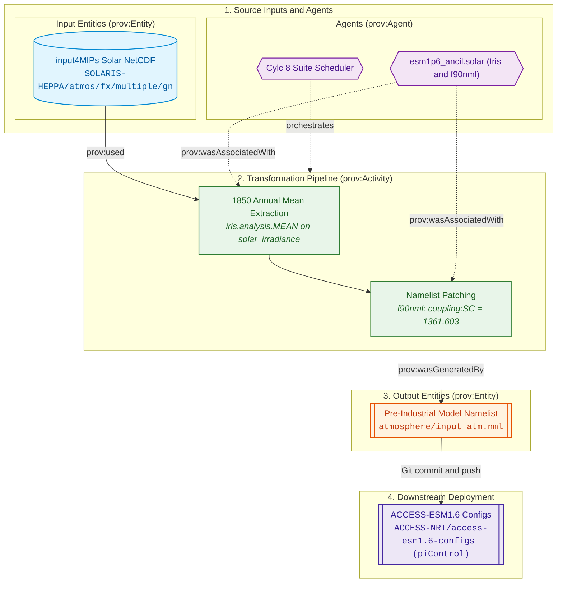
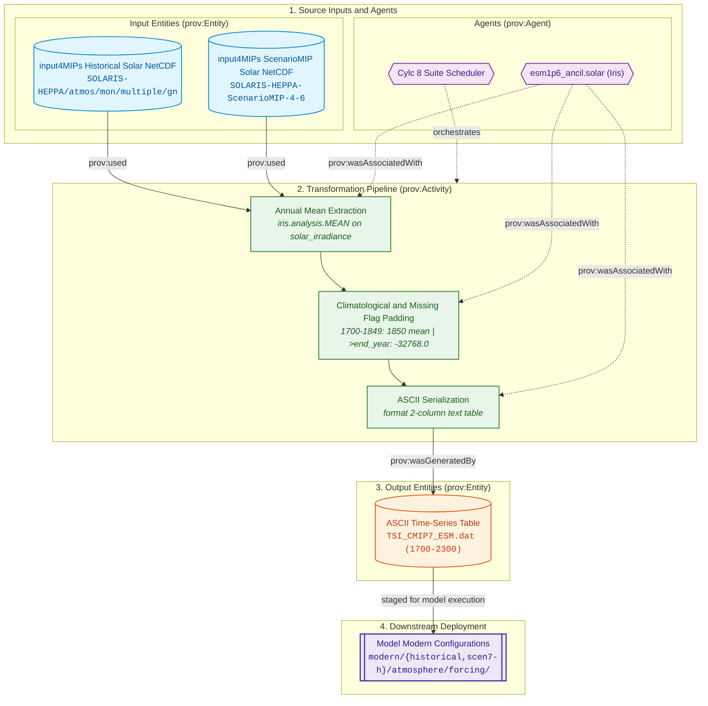

# Solar Irradiance (TSI) Forcing Specifications

The solar irradiance pipeline extracts and calculates Total Solar Irradiance (TSI) in $\text{W}\,\text{m}^{-2}$ from the SOLARIS-HEPPA CMIP7 datasets, patching the solar constant in model coupling namelists for pre-industrial experiments and manufacturing annual timeseries tables for historical and future projection simulations.

---

## Physical Domain & Scientific Scope

* **Physical Quantity:** Total Solar Irradiance ($S_0$, TSI) in $\text{W}\,\text{m}^{-2}$.
* **Source Dataset:** SOLARIS-HEPPA multi-variable solar forcing dataset (`multiple_input4MIPs_solar_...nc`).
* **Experiment Implementations:**
    * **Pre-Industrial Control (`PI`):** Constant scalar $S_0 = 1361.603\,\text{W}\,\text{m}^{-2}$ patched directly into namelist variable `SC` within group `&coupling` in `atmosphere/input_atm.nml`.
    * **Historical (`HI`):** Time-evolving annual mean values from 1850 to 2023 padded into an ASCII table `TSI_CMIP7_ESM` spanning 1700–2300 (years prior to 1850 filled with 1850 mean; years after 2023 set to missing data indicator `-32768.0`).
    * **ScenarioMIP (`SM`):** Future projection annual mean values from 2022 to 2299 padded into an ASCII table `TSI_CMIP7_ESM` spanning 1700–2300.

---

## Provenance & Dataflow Architecture

The solar irradiance pipeline follows the W3C PROV framework, separating into distinct dataflows based on experiment requirements:
* **Pre-Industrial Control (`PI`):** Extracts the time-invariant solar constant and patches model coupling namelists. See [Pre-Industrial Experiment Dataflow Architecture](#pi-dataflow).
* **Historical (`HI`) & ScenarioMIP (`SM`):** Extracts time-evolving annual means and generates multi-century padded ASCII tables. See [Historical & ScenarioMIP Dataflow Architecture](#hi-dataflow).

---

## Controlling Suite Switches

The execution, experiment inclusion, and downstream configuration synchronization for solar irradiance are controlled by parameters in [`rose-suite.conf`](../configuration/suite_objects.md):

* **Master Activation Switch:** `ANCIL_CREATE_SOLAR = true`  
  When set to `false`, all solar irradiance processing tasks are excluded from the execution graph.
* **Experiment Activation:** Governed by `USE_EXP['PI']`, `USE_EXP['HI']`, and `USE_EXP['SM']`.
* **Scenario Extension Controls (`EXTEND_SM_SOLAR`):** `True`  
  Scalar boolean toggle; because SOLARIS-HEPPA ScenarioMIP data natively extends through 2299, ScenarioMIP uses a single common forcing table.
* **Downstream Configuration Branching:**  
  For `PI`, `PI_ancil_solar` directly patches variable `SC` in `${GIT_PI_CONFIG_DIR}/atmosphere/input_atm.nml`. Downstream git branch cloning is managed by `GIT_CONFIG_BRANCH_PRE['PI']` (`dev`) and `GIT_CONFIG_BRANCH_SUF['PI']` (`piControl`), and pushing is gated by `GIT_CONFIG_BRANCH_PUSH = false`. For `HI` and `SM`, tasks produce ASCII table files in the filesystem.
* **Reference:** See [Suite Configuration & Parameters Reference](../configuration/suite_objects.md) for full object declarations.

---

## 1. Pre-Industrial Experiment (PI)

<a id="pi-dataflow"></a>
### Dataflow Architecture

The pre-industrial experiment extracts the time-invariant solar irradiance constant and patches the model namelist:





### `PI_ancil_solar`

* **1. Description & Purpose:**  
  Extracts the pre-industrial solar constant from the time-invariant (`fx`) SOLARIS-HEPPA dataset and patches the `SC` variable in the `&coupling` namelist within the pre-industrial configuration branch.
* **2. CLI Arguments Passed:**  
  ```bash
  python -m esm1p6_ancil.solar.cmip7_PI_solar_generate \
      --ancil-target-dirname "${VAR.ANCIL_TARGET_PATH}" \
      # Current: "/g/data/${PROJECT}/${USER}/CMIP7/esm1p6_ancil/$(isodatetime -f CCYY.MM.DD)"
      --cmip7-source-data-dirname "${VAR.CMIP7_SOURCE_PATH}" \
      # Current: "/g/data/qv56/replicas/input4MIPs/CMIP7"
      --esm15-inputs-dirname "${VAR.ESM15_INPUTS_PATH}" \
      # Current: "/g/data/vk83/configurations/inputs/access-esm1p5"
      --esm-grid-rel-dirname "${ESM_GRID_DIRNAME}" \
      # Current: "global.N96"
      --esm15-grid-version "${ESM15_GRID_VERSION}" \
      # Current: "2020.05.19"
      --dataset-version "${CMIP7_SOLAR_VERSION}" \
      # Current: "SOLARIS-HEPPA-CMIP-4-6"
      --dataset-vdate "${CMIP7_SOLAR_VDATE}"
      # Current: "v20250219"
  ```
* **3. Input4MIPs Versions & Temporal Metadata:**  
    * **Dataset Version:** `${CMIP7_SOLAR_VERSION}` (`SOLARIS-HEPPA-CMIP-4-6`)
    * **Version Date (`vdate`):** `${CMIP7_SOLAR_VDATE}` (`v20250219`)
    * **Frequency:** `fx` (time-invariant)
* **4. Input4MIPs Directory Path & Filenames:**  
    * **Directory Path:** `${VAR.CMIP7_SOURCE_PATH}/CMIP/SOLARIS-HEPPA/${CMIP7_SOLAR_VERSION}/atmos/fx/multiple/gn/${CMIP7_SOLAR_VDATE}/`  
      *(Evaluated: `/g/data/qv56/replicas/input4MIPs/CMIP7/CMIP/SOLARIS-HEPPA/SOLARIS-HEPPA-CMIP-4-6/atmos/fx/multiple/gn/v20250219/`)*
    * **Filename:** `multiple_input4MIPs_solar_CMIP_${CMIP7_SOLAR_VERSION}_gn.nc`
* **5. Python Scripts & Functions:**  
    * **Main Script / Entrypoint:** `esm1p6_ancil.solar.cmip7_PI_solar_generate`
    * **Key Functions Called:** `load_cmip7_solar_cube`, `cmip7_solar_dirpath`, `cmip7_pi_solar_patch`, `f90nml.Parser`
    * **Shared Libraries:** `iris`, `f90nml`
* **6. Function-Level Cube Transformations & Constraints:**  
    * **Input Cubes:** Multi-field `fx` dataset loaded via `iris.load(path)`.
    * **Constraints Applied:** Name constraint `iris.Constraint(name="solar_irradiance")` extracts the TSI cube.
    * **Coordinate Bounds & Manipulation:** Scalar 1-point extraction at index `[0]`. No spatial regridding.
    * **Created / Output Value:** Scalar float `solar_irradiance = 1361.603` $\text{W}\,\text{m}^{-2}$ written to namelist `SC`.
* **7. Produced File Versions & Date Ranges:**  
  `None (Direct namelist generation)`. Time-invariant constant.
* **8. Produced File Directory Paths & Filenames:**  
  `None`.
* **9. Namelist File & Variable Updates:**  
    * **Target File:** `${GIT_PI_CONFIG_DIR}/atmosphere/input_atm.nml`
    * **Namelist Group:** `&coupling`
    * **Variable Updated:** `SC = 1361.603` (Format `.3f`)

---

## 2. Historical Experiment (HI)

<a id="hi-dataflow"></a>
### Dataflow Architecture

The historical and ScenarioMIP experiments follow a unified time-series dataflow architecture, extracting annual means from time-series NetCDF inputs, extending coverage across 1700–2300, and serializing to a 2-column ASCII forcing table:





### `HI_ancil_solar`

* **1. Description & Purpose:**  
  Ingests monthly historical solar irradiance fields (1850–2023), computes annual means, pads timeline from 1700 to 2300, and writes ASCII table file `${ESM_HI_SOLAR_SAVE_FILENAME}` (`TSI_CMIP7_ESM`).
* **2. CLI Arguments Passed:**  
  ```bash
  python -m esm1p6_ancil.solar.cmip7_HI_solar_generate \
      --ancil-target-dirname "${VAR.ANCIL_TARGET_PATH}" \
      # Current: "/g/data/${PROJECT}/${USER}/CMIP7/esm1p6_ancil/$(isodatetime -f CCYY.MM.DD)"
      --cmip7-source-data-dirname "${VAR.CMIP7_SOURCE_PATH}" \
      # Current: "/g/data/qv56/replicas/input4MIPs/CMIP7"
      --esm15-inputs-dirname "${VAR.ESM15_INPUTS_PATH}" \
      # Current: "/g/data/vk83/configurations/inputs/access-esm1p5"
      --esm-grid-rel-dirname "${ESM_GRID_DIRNAME}" \
      # Current: "global.N96"
      --esm15-grid-version "${ESM15_GRID_VERSION}" \
      # Current: "2020.05.19"
      --dataset-version "${CMIP7_SOLAR_VERSION}" \
      # Current: "SOLARIS-HEPPA-CMIP-4-6"
      --dataset-vdate "${CMIP7_SOLAR_VDATE}" \
      # Current: "v20250219"
      --dataset-date-range "${CMIP7_HI_SOLAR_DATE_RANGE}" \
      # Current: "185001-202312"
      --pad \
      --save-filename "${ESM_HI_SOLAR_SAVE_FILENAME}"
      # Current: "TSI_CMIP7_ESM"
  ```
* **3. Input4MIPs Versions & Temporal Metadata:**  
    * Version: `${CMIP7_SOLAR_VERSION}` (`SOLARIS-HEPPA-CMIP-4-6`), `${CMIP7_SOLAR_VDATE}` (`v20250219`), Date Range: `${CMIP7_HI_SOLAR_DATE_RANGE}` (`185001-202312`).
* **4. Input4MIPs Directory Path & Filenames:**  
    * `${VAR.CMIP7_SOURCE_PATH}/CMIP/SOLARIS-HEPPA/${CMIP7_SOLAR_VERSION}/atmos/mon/multiple/gn/${CMIP7_SOLAR_VDATE}/multiple_input4MIPs_solar_CMIP_${CMIP7_SOLAR_VERSION}_gn_${CMIP7_HI_SOLAR_DATE_RANGE}.nc`
* **5. Python Scripts & Functions:** `esm1p6_ancil.solar.cmip7_HI_solar_generate`, `load_cmip7_solar_cube`, `cmip7_solar_year_mean`, `cmip7_solar_save`.
* **6. Cube Transformations:** Extracts `solar_irradiance` cube, collapses monthly slices by year (`year_cube.collapsed("time", iris.analysis.MEAN)`), pads years 1700–1849 with 1850 value, and fills years 2024–2300 with `-32768.0`.
* **7. Produced File:** `${ESM_HI_SOLAR_SAVE_FILENAME}` (`TSI_CMIP7_ESM`, ASCII table, 601 rows for years 1700–2300).
* **8. Destination Path:** `${VAR.ANCIL_TARGET_PATH}/modern/historical/atmosphere/forcing/${ESM_GRID_DIRNAME}/<DATE>/${ESM_HI_SOLAR_SAVE_FILENAME}`.
* **9. Namelist Updates:** `None (Produces ASCII forcing table)`.

---

## 3. ScenarioMIP Experiment (SM)

> [!NOTE]
> **Dataflow Architecture:** ScenarioMIP solar forcing generation uses the same time-series dataflow architecture as the [Historical Experiment (HI)](#hi-dataflow).

### `SM_ancil_solar`

* **1. Description & Purpose:**  
  Generates projection solar irradiance table `${ESM_SM_SOLAR_SAVE_FILENAME}` (`TSI_CMIP7_ESM`) for ScenarioMIP simulations spanning 2022 to 2299.
* **2. CLI Arguments Passed:**  
  ```bash
  python -m esm1p6_ancil.solar.cmip7_SM_solar_generate \
      --ancil-target-dirname "${VAR.ANCIL_TARGET_PATH}" \
      # Current: "/g/data/${PROJECT}/${USER}/CMIP7/esm1p6_ancil/$(isodatetime -f CCYY.MM.DD)"
      --cmip7-source-data-dirname "${VAR.CMIP7_SOURCE_PATH}" \
      # Current: "/g/data/qv56/replicas/input4MIPs/CMIP7"
      --esm15-inputs-dirname "${VAR.ESM15_INPUTS_PATH}" \
      # Current: "/g/data/vk83/configurations/inputs/access-esm1p5"
      --esm-grid-rel-dirname "${ESM_GRID_DIRNAME}" \
      # Current: "global.N96"
      --esm15-grid-version "${ESM15_GRID_VERSION}" \
      # Current: "2020.05.19"
      --dataset-version "${CMIP7_SM_SOLAR_VERSION}" \
      # Current: "SOLARIS-HEPPA-ScenarioMIP-4-6"
      --dataset-vdate "${CMIP7_SM_SOLAR_VDATE}" \
      # Current: "v20260115"
      --dataset-date-range "${CMIP7_SM_SOLAR_DATE_RANGE}" \
      # Current: "202201-229912"
      --pad \
      --save-filename "${ESM_SM_SOLAR_SAVE_FILENAME}"
      # Current: "TSI_CMIP7_ESM"
  ```
* **3. Input4MIPs Versions & Temporal Metadata:**  
    * Version: `${CMIP7_SM_SOLAR_VERSION}` (`SOLARIS-HEPPA-ScenarioMIP-4-6`), `${CMIP7_SM_SOLAR_VDATE}` (`v20260115`), Date Range: `${CMIP7_SM_SOLAR_DATE_RANGE}` (`202201-229912`).
* **7. Produced File:** `${ESM_SM_SOLAR_SAVE_FILENAME}` (`TSI_CMIP7_ESM`, ASCII table, 1700–2300).
* **8. Destination Path:** `${VAR.ANCIL_TARGET_PATH}/modern/scen7-h/atmosphere/forcing/${ESM_GRID_DIRNAME}/<DATE>/${ESM_SM_SOLAR_SAVE_FILENAME}`.
* **9. Namelist Updates:** `None (Produces ASCII forcing table)`.
