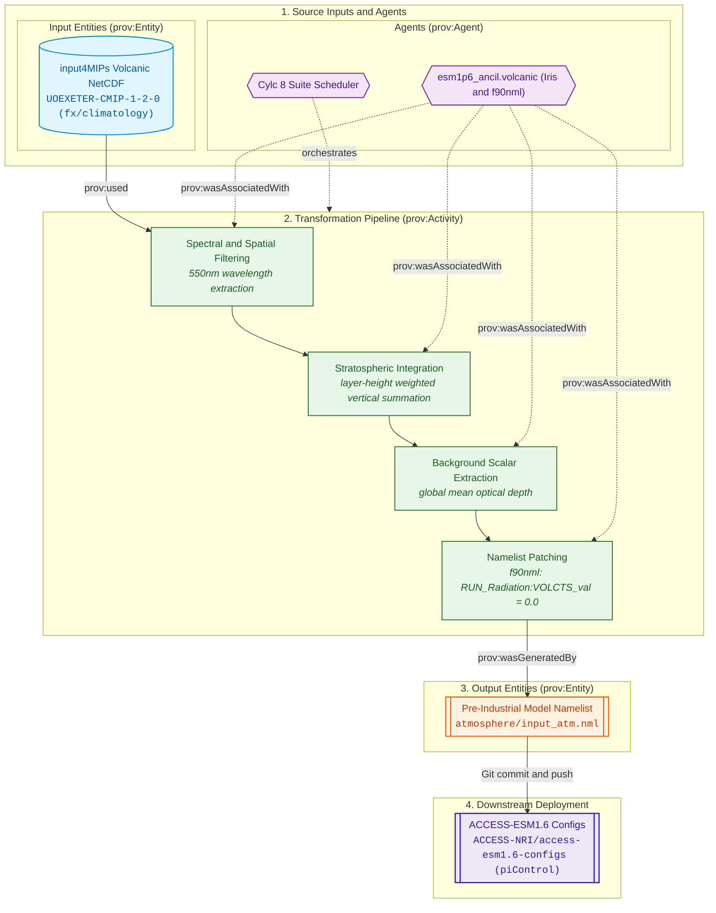
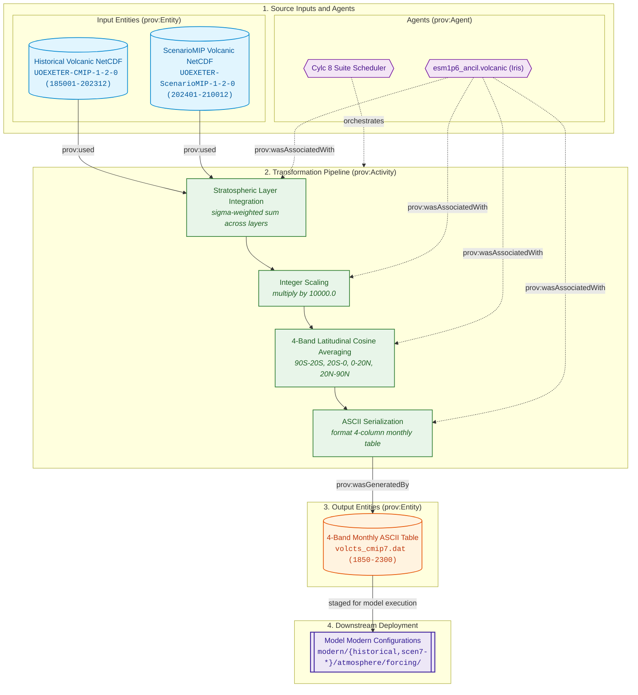

# Volcanic Optical Depth (SAOD) Forcing Specifications

The volcanic optical depth pipeline extracts and integrates stratospheric aerosol optical depth (SAOD) at 550nm wavelength from the UOEXETER CMIP7 datasets, patching pre-industrial coupling namelists and manufacturing 4-band monthly ASCII tables for time-series historical and scenario experiments.

---

## Physical Domain & Scientific Scope

* **Physical Quantity:** Stratospheric Aerosol Optical Depth (SAOD) at $\lambda = 550.0\,\text{nm}$.
* **Vertical Integration:** Layer extinction coefficients ($\text{m}^{-1}$) are summed over stratospheric layers, weighted by layer thickness:
  $$\tau_{\text{strat}} = \sum_k \sigma_{\text{ext}, k} \times \Delta z_k$$
* **Scaling:** Because UM radiation expects integer/scaled optical depth units, optical depth is scaled by:
  $$\text{SAOD}_{\text{scaled}} = \tau_{\text{strat}} \times 10000.0$$
* **Spatial Discretization:**
    * **Pre-Industrial (`PI`):** Globally integrated scalar SAOD constant patched into namelist variable `VOLCTS_val` in `&coupling` in `atmosphere/input_atm.nml`.
    * **Historical (`HI`) & ScenarioMIP (`SM`):** Integrated across 4 equal-area/latitude bands (`90°S–20°S`, `20°S–0°`, `0°–20°N`, `20°N–90°N`) for each month and output into ASCII data table `volcts_cmip7.dat`.

---

## Provenance & Dataflow Architecture

The volcanic SAOD pipeline processes spectral extinction coefficients into model-ready boundary conditions, separating into distinct dataflows based on experiment requirements:
* **Pre-Industrial Control (`PI`):** Derives a single background SAOD scalar and patches the model coupling namelist. See [Pre-Industrial Experiment Dataflow Architecture](#pi-dataflow).
* **Historical (`HI`) & ScenarioMIP (`SM`):** Integrates stratospheric optical depth across 4 latitude bands and serializes to a monthly ASCII forcing table (`volcts_cmip7.dat`). See [Historical & ScenarioMIP Dataflow Architecture](#hi-dataflow).

---

## Controlling Suite Switches

The execution, experiment inclusion, and downstream configuration synchronization for volcanic optical depth are controlled by parameters in [`rose-suite.conf`](../configuration/suite_objects.md):

* **Master Activation Switch:** `ANCIL_CREATE_VOLCANIC = true`  
  When set to `false`, all volcanic optical depth processing tasks are excluded from the execution graph.
* **Experiment Activation:** Governed by `USE_EXP['PI']`, `USE_EXP['HI']`, and `USE_EXP['SM']`.
* **Scenario Extension Controls (`EXTEND_SM_VOLCANIC`):** `True`  
  Scalar boolean toggle; because UOEXETER ScenarioMIP volcanic data is padded to 2300, a single common table is generated across ScenarioMIP pathways.
* **Downstream Configuration Branching:**  
  For `PI`, `PI_ancil_volcanic` directly patches variable `VOLCTS_val` in `${GIT_PI_CONFIG_DIR}/atmosphere/input_atm.nml`. Downstream git branch cloning is managed by `GIT_CONFIG_BRANCH_PRE['PI']` (`dev`) and `GIT_CONFIG_BRANCH_SUF['PI']` (`piControl`), and pushing is gated by `GIT_CONFIG_BRANCH_PUSH = false`. For `HI` and `SM`, tasks produce ASCII table files in the filesystem.
* **Reference:** See [Suite Configuration & Parameters Reference](../configuration/suite_objects.md) for full object declarations.

---

## 1. Pre-Industrial Experiment (PI)

<a id="pi-dataflow"></a>
### Dataflow Architecture

The pre-industrial volcanic workflow integrates background stratospheric aerosol extinction into a single scalar value and patches the model namelist:





### `PI_ancil_volcanic`

* **1. Description & Purpose:**  
  Computes the pre-industrial background stratospheric aerosol optical depth (SAOD) from UOEXETER climatology, integrating across 550nm wavelength, stratospheric vertical layers, and latitude bands. Patches `VOLCTS_val` in the `&coupling` namelist.
* **2. CLI Arguments Passed:**  
  ```bash
  python -m esm1p6_ancil.volcanic.cmip7_PI_volcanic_generate \
      --ancil-target-dirname "${VAR.ANCIL_TARGET_PATH}" \
      # Current: "/g/data/${PROJECT}/${USER}/CMIP7/esm1p6_ancil/$(isodatetime -f CCYY.MM.DD)"
      --cmip7-source-data-dirname "${VAR.CMIP7_SOURCE_PATH}" \
      # Current: "/g/data/qv56/replicas/input4MIPs/CMIP7"
      --esm15-inputs-dirname "${VAR.ESM15_INPUTS_PATH}" \
      # Current: "/g/data/vk83/configurations/inputs/access-esm1p5"
      --dataset-version "${CMIP7_VOLCANIC_VERSION}" \
      # Current: "UOEXETER-CMIP-2-2-1"
      --dataset-vdate "${CMIP7_VOLCANIC_VDATE}" \
      # Current: "v20250521"
      --dataset-date-range "${CMIP7_PI_VOLCANIC_DATE_RANGE}"
      # Current: "185001-202112"
  ```
* **3. Input4MIPs Versions & Temporal Metadata:**  
    * **Dataset Version:** `${CMIP7_VOLCANIC_VERSION}` (`UOEXETER-CMIP-2-2-1`)
    * **Version Date (`vdate`):** `${CMIP7_VOLCANIC_VDATE}` (`v20250521`)
    * **Date Range:** `${CMIP7_PI_VOLCANIC_DATE_RANGE}` (`185001-202112`, `-clim.nc` climatology)
* **4. Input4MIPs Directory Path & Filenames:**  
    * **Directory Path:** `${VAR.CMIP7_SOURCE_PATH}/CMIP/uoexeter/${CMIP7_VOLCANIC_VERSION}/atmos/monC/ext/gnz/${CMIP7_VOLCANIC_VDATE}/`  
      *(Evaluated: `/g/data/qv56/replicas/input4MIPs/CMIP7/CMIP/uoexeter/UOEXETER-CMIP-2-2-1/atmos/monC/ext/gnz/v20250521/`)*
    * **Filename:** `ext_input4MIPs_aerosolProperties_CMIP_${CMIP7_VOLCANIC_VERSION}_gnz_${CMIP7_PI_VOLCANIC_DATE_RANGE}-clim.nc`
* **5. Python Scripts & Functions:**  
    * **Main Script / Entrypoint:** `esm1p6_ancil.volcanic.cmip7_PI_volcanic_generate`
    * **Key Functions Called:** `average_stratospheric_aerosol_optical_depth`, `cmip7_volcanic_dirpath`, `constrain_to_wavelength`, `mean_over_pi_months`, `mean_over_latitudes`, `sum_over_height_layers`, `cmip7_pi_volcanic_patch`, `f90nml.Parser`
    * **Shared Libraries:** `iris`, `numpy`, `cftime`, `f90nml`
* **6. Function-Level Cube Transformations & Constraints:**  
    * **Input Cubes:** 4D climatological extinction cube loaded via `iris.load_cube` with dimensions `(time: 12, wavelength, lat, height)`.
    * **Constraints Applied:** Wavelength constraint `iris.Constraint(radiation_wavelength=550.0e-9)`.
    * **Coordinate Bounds & Manipulation:**
        * Temporal bounds verified via `time_coord.has_bounds()`; if missing, `guess_bounds()`.
        * Time average calculated across 12 months weighted by monthly day fractions (`time_weights = np.diff(np.append(points, [365])) / 365.0`) collapsing `time` with `iris.analysis.MEAN`.
        * NaN stratospheric cells zeroed via `np.nan_to_num(cube.data, copy=False)`.
        * Latitude averaged with cosine area weights via `iris.analysis.cartography.cosine_latitude_weights(cube)`.
        * Vertical integration: Collapsed over `height_above_mean_sea_level` with `iris.analysis.SUM`, weighted by stratospheric layer height bounds `np.diff(height_coord.bounds).flatten()`.
    * **Created / Output Value:** Reduces 4D cube to scalar float `average_saod`, multiplied by scaling factor `SAOD_SCALING = 10000.0`.
* **7. Produced File Versions & Date Ranges:**  
  `None (Direct namelist generation)`. Pre-industrial background climatology.
* **8. Produced File Directory Paths & Filenames:**  
  `None`.
* **9. Namelist File & Variable Updates:**  
    * **Target File:** `${GIT_PI_CONFIG_DIR}/atmosphere/input_atm.nml`
    * **Namelist Group:** `&coupling`
    * **Variable Updated:** `VOLCTS_val = <average_saod * 10000.0>` (Format `6.2f`, e.g. `0.17`)

---

## 2. Historical Experiment (HI)

<a id="hi-dataflow"></a>
### Dataflow Architecture

The historical and ScenarioMIP volcanic pipelines integrate stratospheric aerosol extinction vertically, average across 4 latitude bands, scale values ($\times 10^4$), and serialize to monthly 4-column ASCII forcing tables:





### `HI_ancil_volcanic`

* **1. Description & Purpose:**  
  Integrates historical monthly stratospheric extinction fields (1850–2023) across 550nm wavelength and stratospheric height, averages into 4 latitude bands, scales by 10000, and writes `${ESM_HI_VOLCANIC_SAVE_FILENAME}` (`volcts_cmip7.dat`).
* **2. CLI Arguments Passed:**  
  ```bash
  python -m esm1p6_ancil.volcanic.cmip7_HI_volcanic_generate \
      --ancil-target-dirname "${VAR.ANCIL_TARGET_PATH}" \
      # Current: "/g/data/${PROJECT}/${USER}/CMIP7/esm1p6_ancil/$(isodatetime -f CCYY.MM.DD)"
      --cmip7-source-data-dirname "${VAR.CMIP7_SOURCE_PATH}" \
      # Current: "/g/data/qv56/replicas/input4MIPs/CMIP7"
      --esm15-inputs-dirname "${VAR.ESM15_INPUTS_PATH}" \
      # Current: "/g/data/vk83/configurations/inputs/access-esm1p5"
      --dataset-version "${CMIP7_VOLCANIC_VERSION}" \
      # Current: "UOEXETER-CMIP-2-2-1"
      --dataset-vdate "${CMIP7_VOLCANIC_VDATE}" \
      # Current: "v20250521"
      --dataset-date-range "${CMIP7_HI_VOLCANIC_DATE_RANGE}" \
      # Current: "175001-202312"
      --pad \
      --save-filename "${ESM_HI_VOLCANIC_SAVE_FILENAME}"
      # Current: "volcts_cmip7.dat"
  ```
* **3. Input4MIPs Versions & Temporal Metadata:**  
    * Version: `${CMIP7_VOLCANIC_VERSION}` (`UOEXETER-CMIP-2-2-1`), `${CMIP7_VOLCANIC_VDATE}` (`v20250521`), Date Range: `${CMIP7_HI_VOLCANIC_DATE_RANGE}` (`175001-202312`).
* **4. Input4MIPs Directory Path & Filenames:**  
    * Path: `${VAR.CMIP7_SOURCE_PATH}/CMIP/uoexeter/${CMIP7_VOLCANIC_VERSION}/atmos/mon/ext/gnz/${CMIP7_VOLCANIC_VDATE}/`  
      *(Evaluated: `/g/data/qv56/replicas/input4MIPs/CMIP7/CMIP/uoexeter/UOEXETER-CMIP-2-2-1/atmos/mon/ext/gnz/v20250521/`)*
    * Filename: `ext_input4MIPs_aerosolProperties_CMIP_${CMIP7_VOLCANIC_VERSION}_gnz_${CMIP7_HI_VOLCANIC_DATE_RANGE}.nc`
* **5. Scripts & Functions:** `esm1p6_ancil.volcanic.cmip7_HI_volcanic_generate`, `save_stratospheric_aerosol_optical_depth`, `constrain_to_wavelength`, `sum_over_height_layers`.
* **6. Cube Transformations:**
    * Constrained to 550nm wavelength.
    * Stratospheric layer height integration for each month.
    * Latitude averaging across 4 discrete bands (`90°S–20°S`, `20°S–0°`, `0°–20°N`, `20°N–90°N`).
    * Scaled by 10000.0. Pre-1850 years filled with pre-industrial mean via `print_early_saod`. Post-2023 years tapered or padded.
* **7. Produced File:** `${ESM_HI_VOLCANIC_SAVE_FILENAME}` (`volcts_cmip7.dat`, ASCII table, columns: `year month band1 band2 band3 band4`).
* **8. Destination Path:** `${VAR.ANCIL_TARGET_PATH}/modern/historical/atmosphere/forcing/${ESM_GRID_DIRNAME}/<DATE>/${ESM_HI_VOLCANIC_SAVE_FILENAME}`.
* **9. Namelist Updates:** `None (Produces ASCII forcing table)`.

---

## 3. ScenarioMIP Experiment (SM)

> [!NOTE]
> **Dataflow Architecture:** ScenarioMIP volcanic forcing generation uses the same time-series dataflow architecture as the [Historical Experiment (HI)](#hi-dataflow).

### `SM_ancil_volcanic`

* **1. Description & Purpose:**  
  Generates projection 4-band volcanic SAOD table `${ESM_SM_VOLCANIC_SAVE_FILENAME}` (`volcts_cmip7.dat`) for ScenarioMIP simulations spanning 2022 to 2100 (tapering/holding constant to 2300).
* **2. CLI Arguments Passed:**  
  ```bash
  python -m esm1p6_ancil.volcanic.cmip7_SM_volcanic_generate \
      --ancil-target-dirname "${VAR.ANCIL_TARGET_PATH}" \
      # Current: "/g/data/${PROJECT}/${USER}/CMIP7/esm1p6_ancil/$(isodatetime -f CCYY.MM.DD)"
      --cmip7-source-data-dirname "${VAR.CMIP7_SOURCE_PATH}" \
      # Current: "/g/data/qv56/replicas/input4MIPs/CMIP7"
      --esm15-inputs-dirname "${VAR.ESM15_INPUTS_PATH}" \
      # Current: "/g/data/vk83/configurations/inputs/access-esm1p5"
      --dataset-version "${CMIP7_SM_VOLCANIC_VERSION}" \
      # Current: "UOEXETER-ScenarioMIP-2-2-2"
      --dataset-vdate "${CMIP7_SM_VOLCANIC_VDATE}" \
      # Current: "v20251219"
      --dataset-date-range "${CMIP7_SM_VOLCANIC_DATE_RANGE}" \
      # Current: "202201-210012"
      --pad \
      --save-filename "${ESM_SM_VOLCANIC_SAVE_FILENAME}"
      # Current: "volcts_cmip7.dat"
  ```
* **3. Input4MIPs Versions & Temporal Metadata:**  
    * Version: `${CMIP7_SM_VOLCANIC_VERSION}` (`UOEXETER-ScenarioMIP-2-2-2`), `${CMIP7_SM_VOLCANIC_VDATE}` (`v20251219`), Date Range: `${CMIP7_SM_VOLCANIC_DATE_RANGE}` (`202201-210012`).
* **7. Produced File:** `${ESM_SM_VOLCANIC_SAVE_FILENAME}` (`volcts_cmip7.dat`, ASCII table, 1850–2300).
* **8. Destination Path:** `${VAR.ANCIL_TARGET_PATH}/modern/scen7-h/atmosphere/forcing/${ESM_GRID_DIRNAME}/<DATE>/${ESM_SM_VOLCANIC_SAVE_FILENAME}`.
* **9. Namelist Updates:** `None (Produces ASCII forcing table)`.
